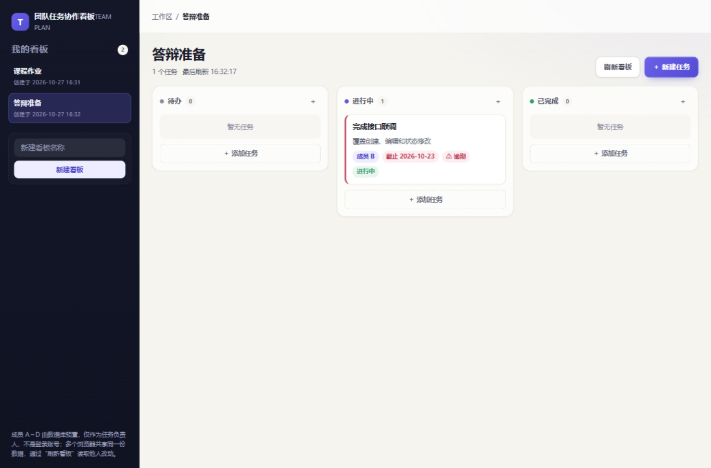

# 团队任务协作看板

“AI生成式软件”课程的四人协作项目：轻量版 Trello，用多个看板管理任务，展示负责人、截止日期和完成状态。

**当前状态：P0（REQ-001～015）已实现并通过核心回归，M4 选做未选择。** 交付内容包含 shared 契约与纯规则、
后端成员/看板/任务 API、Vue 3 前端看板与任务工作区、数据库迁移与种子、演示数据与重置命令、单元/集成测试、
一键 API 回归脚本与双浏览器 E2E 脚本。验证记录见 [verification/](verification/README.md)，
逐条结果见 [TASK-032 最终回归](verification/TASK-032-final-regression.md)（CHECK-001～043：41 项通过、
CHECK-029/030 的 Chrome 品牌项待补验）。

## 预期效果



任务详情与窄屏布局见 [verification/screenshots](verification/screenshots/)；原型参考见
[prototype/screenshots](prototype/screenshots/)，界面风格沿用 [global.css](prototype/styles/global.css)。

## 文档导航

| 文档 | 内容 |
| --- | --- |
| [spec.md](spec.md) | 功能规格、业务规则、API 契约、设计假设与风险 |
| [architecture.md](architecture.md) | 系统结构、模块接口、数据流、部署方式、M1 冻结决议 |
| [tasks.md](tasks.md) | M1～M5 实现计划、四人分工、依赖与任务状态 |
| [checklist.md](checklist.md) | 核心与选做功能的可复现验证步骤 |
| [verification/](verification/README.md) | 实测记录：联调、双浏览器、API 回归、最终回归与截图 |

阅读顺序：功能规格 → 系统架构 → 实现计划 → 验证清单 → 验证记录。

## 功能范围

| 优先级 | 状态 |
| --- | --- |
| P0：创建/切换看板；任务增删改查；标题、描述、截止日期、负责人、状态；状态任意双向流转；持久化、校验、错误恢复、本地演示 | **已实现并验收** |
| P1：任务优先级、筛选、跨列拖拽与同列排序 | 未选择、未实施 |
| P2：可撤销只读分享与维护密钥访问控制 | 未选择、未实施 |

任务状态统一为 `todo`（待办）、`doing`（进行中）、`done`（已完成）。负责人来自数据库预置的成员 A～D，
可留空；多个浏览器访问同一后端，通过“刷新看板”读取他人改动；完整 PUT 编辑采用“后提交成功者覆盖”。

## 技术方案与目录

| 层次 | 技术 |
| --- | --- |
| 前端 | Vue 3 + TypeScript + Vite（`frontend/`） |
| 后端 | Node.js + Express 5 + TypeScript（`backend/`） |
| 共享契约 | `shared/`（类型、错误码、文本/日期纯规则，输出 ESM + CJS 双产物） |
| 数据库 | SQLite（better-sqlite3，无 ORM，参数化 SQL 与迁移校验和） |

```text
shared/     contracts（类型/错误码）+ rules（文本、日期、枚举、字段文案）
backend/    http（路由、校验、错误、日志）+ modules（业务）+ db（SQL、事务、迁移、种子）
frontend/   api（统一客户端）+ state（工作区状态）+ features（看板、任务、健康门禁）+ pages
tests/e2e/  双浏览器端到端脚本
scripts/    一键 HTTP 回归脚本
verification/ 实测记录与截图
```

## 运行环境（本机验证版本）

| 项 | 版本 |
| --- | --- |
| Node / npm | v24.18.0 / 11.16.0（`engines` 声明 `>=18.17`） |
| 操作系统 | Windows 10.0.26200 x64 |
| 浏览器 | Microsoft Edge 156.0.4314.42（E2E 实测）；开发与演示同样支持其它 Chromium 内核浏览器 |
| 数据库 | SQLite 文件（默认 `data/team-plan.sqlite`；演示库 `data/team-plan-demo.sqlite`） |

依赖通过根 `package-lock.json` 锁定；根目录为 npm workspaces（shared / backend / frontend）。

## 快速开始

```powershell
npm install                    # 按锁文件安装（首次会本地编译 better-sqlite3）
Copy-Item .env.example .env     # 按需修改；不改也能用默认值
npm run db:init                 # 建库、应用迁移、写入四名固定成员（可重复执行，不删数据）
npm run dev                     # shared 监听 + 后端 127.0.0.1:3000 + 前端 127.0.0.1:5173
```

打开 <http://127.0.0.1:5173>（开发，Vite 代理 `/api` 到后端）；或用构建后单服务演示：

```powershell
npm run build
DATABASE_PATH=data/team-plan-demo.sqlite NODE_ENV=production npm start   # 打开 http://127.0.0.1:3000
```

## 常用命令

| 命令 | 用途 |
| --- | --- |
| `npm run typecheck` | 三个包的类型检查（先构建 shared） |
| `npm test` | shared / backend / frontend 全部单元与集成测试 |
| `npm run build` | shared → backend → frontend 生产构建 |
| `npm run check:api` | **一键 HTTP 回归**：临时数据库 + 真实服务，检查契约与安全边界 |
| `npm run test:e2e` | **双浏览器 E2E**（需服务已启动；`E2E_BROWSER=chrome` 可换 Chrome 记录） |
| `npm run db:init` | 建库、迁移、固定成员种子（幂等，不清理业务数据） |
| `npm run db:demo` | 生成演示数据（10 看板 / 200 任务，只写演示库；重复执行不重复写入） |
| `npm run db:reset-demo` | 删除演示库（默认要求输入 yes；非交互用 `npm run db:reset-demo:yes`） |
| `npm start` / `npm run dev:backend` / `npm run dev:frontend` | 构建后启动 / 开发模式分别启动 |

## 配置

`.env.example` 列出全部配置键；`.env` 不入库。关键项：

| 键 | 默认 | 说明 |
| --- | --- | --- |
| `HOST` / `PORT` | `127.0.0.1` / `3000` | 默认只监听回环；端口占用即启动失败 |
| `ALLOWED_HOSTS` | 空 | 监听非回环地址时**必须**显式配置，否则拒绝启动；为空时只接受 `127.0.0.1`、`localhost`、`[::1]` |
| `DATABASE_PATH` | `data/team-plan.sqlite` | 相对路径以项目根解析；库文件缺失时启动失败，请先 `db:init` |
| `ENABLE_PRIORITY/FILTERS/ORDERING/SHARING` | `0` | P0 交付必须全为 0；扩展未实现时置 1 会拒绝启动 |
| `EDITOR_KEY` | 无 | 仅 P2 分享功能使用，P0 不读取 |
| `DEMO_DATABASE_PATH` | `data/team-plan-demo.sqlite` | 可选：演示数据与重置命令的目标文件 |

说明：`GET /api/v1/health` 返回服务与数据库可读性、迁移版本与校验和一致性、功能开关；
它**只代表服务与结构可用**，不代表已有业务数据（空库也返回 200）。数据库不可读或结构不一致时返回 503。

## 备份、恢复与演示重置

> 只在可丢弃的数据库上练习破坏性操作；演示库与主库相互独立。

```powershell
# 备份（必须先停服并确认所有连接已关闭）
Stop-Process -Name node            # 或在对应终端 Ctrl+C
Copy-Item data/team-plan.sqlite data/team-plan-YYYYMMDD.sqlite

# 恢复：停服后把备份复制回配置路径，再启动
Copy-Item data/team-plan-YYYYMMDD.sqlite data/team-plan.sqlite
npm start                          # 启动会核对迁移编号与校验和，不一致则拒绝启动

# 演示数据（独立演示库，只清理演示数据）
npm run db:demo
npm run db:reset-demo              # 需要输入 yes 确认；文件名不含 demo 时拒绝执行
```

恢复失败不会自动删库或降级迁移；迁移文件被改写、缺号或重号都会导致启动失败（见
`backend/tests/migrations.test.ts` 与 `startup.test.ts`）。

## 验收与验证记录

- 核心验收逐条结论：[verification/TASK-032-final-regression.md](verification/TASK-032-final-regression.md)
  （CHECK-001～043；41 项通过，CHECK-029/030 的 Edge 与 Chromium 部分通过、Chrome 品牌项待补验）。
- 第一次真实联调：[verification/TASK-015-first-integration.md](verification/TASK-015-first-integration.md)
- 双浏览器与失败恢复：[verification/TASK-017-dual-browser.md](verification/TASK-017-dual-browser.md)
- API 契约与安全边界：[verification/TASK-018-api-regression.md](verification/TASK-018-api-regression.md)
- 演示脚本：[verification/demo-script.md](verification/demo-script.md)

复现全部检查：

```powershell
npm ci && npm run db:init && npm run typecheck && npm test && npm run build && npm run check:api
npm run db:demo
DATABASE_PATH=data/team-plan-demo.sqlite NODE_ENV=production npm start   # 保持运行
npm run test:e2e        # 另开终端
```

## 已知限制

- 完整 PUT 覆盖：后提交成功的更新覆盖先前更新，不自动合并字段，无版本锁；编辑前会比对 `updatedAt` 给出覆盖提示。
- 无实时同步：其他浏览器需手动“刷新看板”；刷新失败保留当前数据并标记可能已过期。
- 单实例 SQLite：写事务串行，锁等待超过 5000 ms 返回 503，可人工重试；不承诺并发写吞吐。
- 客户端 10 秒超时只结束本地等待，超时后请先刷新查证，客户端不会自动重放写请求。
- 无登录、无按用户权限、无分页、无撤销删除；P2 分享功能未实施。
- 服务默认无 TLS，如用于可信局域网演示需显式配置 `HOST` 与 `ALLOWED_HOSTS`。

## 四人分工

| 成员 | 主要开发责任 |
| --- | --- |
| 成员 A | 看板导航、任务三列展示、刷新与请求竞态；选做拖拽和分享 UI（未选） |
| 成员 B | 后端骨架、数据库与迁移、看板 API、本地部署、演示与重置命令 |
| 成员 C | 前端骨架、任务表单、状态/删除/日期与界面适配 |
| 成员 D | 统一 API 客户端与 shared 契约、成员与任务 API、双浏览器与 API 回归 |

共享维护约定与提交规范见 [tasks.md](tasks.md) 第 5 节：提交标题统一 `类型: 中文说明`
（`feat`/`fix`/`docs`/`test`/`refactor`/`chore`），每个任务使用短分支并注明 TASK/REQ 与测试结果。

## 待确认事项

课程方的技术栈/部署限制、负责人与日期是否必填、选做评分与投入时间等仍未确认，继续按
[spec.md](spec.md) 第 10 节的 `A-01`～`A-09` 假设与 `Q-01`～`Q-11` 推进；新增范围须先修订文档与计划。