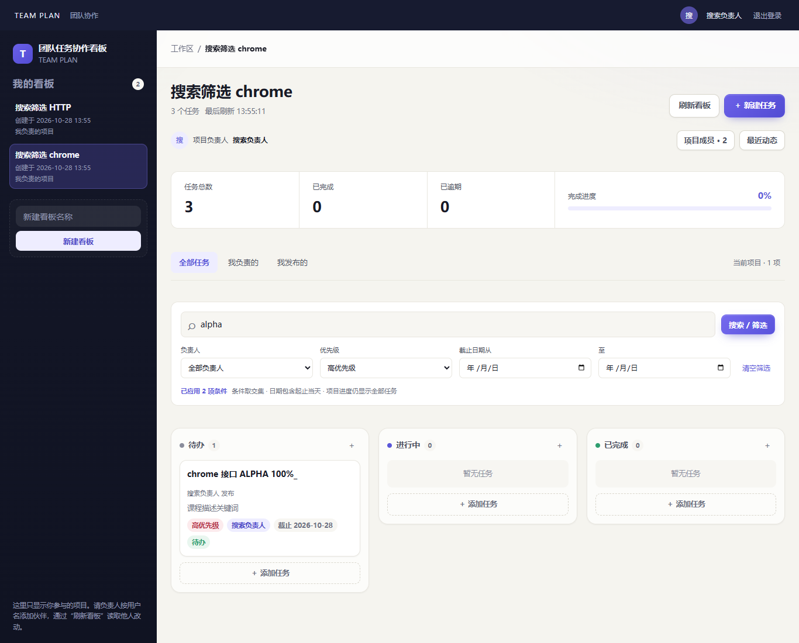

# 团队任务协作看板

“AI生成式软件”课程的四人协作项目。通过多个看板管理任务，在待办、进行中、已完成三列中查看进度，并维护负责人和截止日期。

项目采用**人定义场景与验收、AI 生成端到端切片、机器回归、人独立复验**的开发方式。分工和进度不看代码行数，而看可运行、可演示的用户结果。

## 在线演示

**访问：<https://tboard.bigdogaaa.cn/>**

站点于 2026-10-27 上线，账号协作版新增个人注册登录和项目成员权限。登录页可直接打开，项目数据仅对项目成员开放；线上实际版本见 [部署记录](deploy/DEPLOYMENT.md)。

注册账号（用户名、昵称和至少 12 位密码），创建看板即成为项目负责人。请伙伴先注册，再在“项目成员”中按用户名添加。任务自动记录发布者，可分配给项目成员；通过“刷新看板”读取他人的修改。



## 已实现功能

- 创建、查看和切换多个看板，支持直接打开看板链接。
- 新建、查看、编辑和删除任务，在三种状态间切换。
- 注册、登录、退出、会话恢复、修改昵称和密码；改密撤销其他会话。
- 项目负责人、添加/移除成员、负责人转交及项目访问隔离。
- 任务发布者自动记录，负责人从项目成员中选择，支持截止日期和逾期提示。
- “我负责的 / 我发布的”任务视图、项目进度、最近操作动态。
- 高/中/低优先级，按标题/描述关键词、负责人、截止日期组合筛选；支持清空、空结果与失败重试。
- SQLite 持久化、手动刷新、错误恢复、窄屏适配与键盘操作。
- 公网 HTTPS、个人会话保护、服务开机自启和每日数据库备份。

拖拽、只读分享、评论、邮件/短信找回密码和实时同步尚未实现。

## 验证与交付状态

当前 229 项单元/集成测试（shared 20 + backend 140 + frontend 69）、50 项兼容 API 回归、22 项跨浏览器 E2E、8 组双账号协作及 15 组优先级/搜索验收通过；类型检查、生产构建和双品牌故障/竞态验证通过。见 [搜索筛选验证](verification/task-search/README.md) 和 [账号协作验收](verification/accounts-projects/README.md)。公网结果单独记入 [部署记录](deploy/DEPLOYMENT.md)，不将本地测试当作线上结果。

成员 A 的 S1 回归已接入真实账号；旧版本的 190 项记录保留在 [成员 A 的 S1 记录](verification/member-a-s1/README.md)。

S1～S4 的实现与自测已完成，组员独立人工验收尚未执行，按用户决定不阻塞本次公网演示。历史 CHECK 结论保留在 [验证清单](checklist.md)，候选包阶段的补验与打包方式见 [候选交付记录](verification/RELEASE-candidate.md)。

## 获取项目

```sh
git clone https://github.com/233zsq/teams-task-board.git
cd teams-task-board
```

## 本地运行

已验证环境：Windows 10.0.26200 x64、Node.js 24.18.0、npm 11.16.0、Edge 156.0.4314.42；
当前 `engines` 为 Node.js `>=18.17`，依赖版本以锁文件为准。课程机采用其他版本时，应实际复验并更新记录。

### 开发模式（Vite + Express）

```powershell
npm ci
Copy-Item .env.example .env
npm run db:init          # 建库、迁移 0001/0002、保留四名历史成员；可重复执行
npm run dev              # shared 监听 + 后端 127.0.0.1:3000 + 前端 127.0.0.1:5173
```

打开 <http://127.0.0.1:5173>。Vite 代理 `/api` 到 `127.0.0.1:3000`。

### 构建后单服务演示

```powershell
npm run build
$env:DATABASE_PATH="data/team-plan-demo.sqlite"; $env:NODE_ENV="production"; npm start
```

打开 <http://127.0.0.1:3000>；静态页面与 API 同源，深链接刷新由 SPA 回退处理，未知 `/api` 仍返回 JSON 404。

### 演示数据与重置

```powershell
npm run db:demo           # 演示库写入 10 看板 / 200 任务；重复执行不重复写入
npm run db:reset-demo     # 只删除演示库，需输入 yes 确认；非交互用 db:reset-demo:yes
```

演示库默认 `data/team-plan-demo.sqlite`，与 `DATABASE_PATH` 的主库互相独立；重置命令拒绝删除文件名不含 `demo` 的数据库。

### 备份与恢复

```powershell
# 停服并确认连接已关闭后备份
Copy-Item data/team-plan.sqlite data/team-plan-YYYYMMDD.sqlite
# 恢复：停服后覆盖回配置路径，再启动（启动会核对迁移编号与校验和）
Copy-Item data/team-plan-YYYYMMDD.sqlite data/team-plan.sqlite
npm start
```

恢复失败不会自动删库或降级迁移。实测记录见 [verification/TASK-032-final-regression.md](verification/TASK-032-final-regression.md)。

### 检查命令

```powershell
npm run typecheck        # 三个包类型检查
npm test                 # shared + backend + frontend（229 项）
npm run check:api        # 一键 HTTP 契约与安全回归（临时库，50 项）
npm run test:e2e         # 双浏览器 E2E（需服务已启动；E2E_BROWSER=chrome 可换 Chrome）
npm run test:e2e:launcher # 浏览器选择与禁止静默回退的回归
npm run test:e2e:s1      # 构建后使用临时库/随机端口，真实创建、刷新与重启，无需预启动服务
# 隔离服务、临时库及 Chrome/Edge 配置见 verification/RELEASE-candidate.md
npm run check:browser
npm run check:accounts   # 临时库、双账号注册与项目权限的完整浏览器流程
npm run check:search     # 开启优先级/筛选的 HTTP + Chrome/Edge 完整场景
```

- `npm run db:init` 只应用待执行迁移并幂等写入四名固定成员，可重复执行，不删除看板或任务。
- 默认启用优先级/搜索；旧 `.env` 可将 `ENABLE_PRIORITY=1`、`ENABLE_FILTERS=1`。两项同时设为 0 可保留旧 API，已有优先级不会被清除。`check:api` 固定验证关闭扩展的兼容模式，`check:search` 验证开启模式。
- 数据库未初始化、结构不兼容或配置无效时，服务明确失败，不回退到内存库或另一个空库。
- 配置键以 `.env.example` 为入口；`.env` 和本地数据库不提交仓库。

## 界面与原型参考

原型是开发时的视觉与交互参考，保留在 [prototype/screenshots](prototype/screenshots/)；样式参考 [global.css](prototype/styles/global.css)。当前运行效果以上方公网截图和实测记录为准。

实际运行界面（2026-10-27 实测）：[看板与任务卡片](verification/screenshots/board-with-task.png)、
[任务详情](verification/screenshots/task-detail.png)、[360 窄屏](verification/screenshots/narrow-360.png)、
[演示库看板](verification/screenshots/board-demo.png)。

## 文档导航

| 目的 | 入口 |
| --- | --- |
| 了解分工、当前切片和完成门禁 | [tasks.md](tasks.md) |
| 查看用户场景、业务规则、字段和 API 契约 | [spec.md](spec.md) |
| 理解实际架构、关键约束与技术决策 | [architecture.md](architecture.md) |
| 执行切片验收与最终复演 | [checklist.md](checklist.md) |
| 给编码代理提供仓库操作约束 | [AGENTS.md](AGENTS.md) |
| 查看 AI 输入、首次结果、人工修正与验证证据 | [ai-log.md](ai-log.md) |
| 查看实测记录、截图与逐条 CHECK 结论 | [verification/](verification/README.md) |
| 运行浏览器补验、打包与组员独立复验 | [候选交付说明](verification/RELEASE-candidate.md) |
| 成员 A 的 S1 计划、重启验证与独立验收入口 | [成员 A 交接](verification/member-a-s1/README.md) |

课程补充材料：[飞书文档](https://hypersmart.feishu.cn/wiki/IK4YwAvp6i3X9hk5Ih1csuTjn9g)。外部材料的具体要求以课程方发布为准。

## 切片分工

| 切片 | 用户结果 | 主驾 | 独立验收 |
| --- | --- | --- | --- |
| S1 | 建看板、建任务、三列/详情、真实持久化 | A | C |
| S2 | 多看板切换、直接链接、空态与加载恢复 | B | D |
| S3 | 编辑、删除、状态、日期、键盘和窄屏操作 | C | A |
| S4 | 双浏览器、异常、安全、备份恢复与交付加固 | D | B |
| S5 | 核心通过后选择一个完整扩展 | 待定 | 非主驾成员 |

S1 后，S2 与 S3 可并行。每个切片同时交付所需的 UI、API、数据变更、测试和真实演示，不再按技术层等待联调。完整范围与旧任务映射见 [tasks.md](tasks.md)。

## 产品边界

- **P0 必做：** 看板创建/查看/切换；任务增删改查、负责人、截止日期、状态与逾期；SQLite 持久化、错误恢复、多浏览器人工刷新、本地交付。
- **P1 选做：** 优先级、筛选、拖拽与排序。
- **P2 选做：** 带完整访问控制的只读分享。

账号版通过 REQ-020～025 增加真实账号、项目负责人/成员、任务发布者与个人视图。旧版 A～D 仅为历史任务保留，不用于新项目分配。任务状态为 `todo`、`doing`、`done`，允许任意双向流转。完整规则以 [spec.md](spec.md) 为准。

## 已知限制

- **完整 PUT 覆盖**：后提交成功的更新覆盖先前更新，不合并字段、无版本锁；编辑前比对 `updatedAt` 给出覆盖提示。
- **无实时同步**：其他浏览器需手动“刷新看板”；刷新失败保留当前数据并标记可能已过期。
- **单实例 SQLite**：写事务串行，锁等待超过 5000 ms 返回 503；不承诺并发写吞吐。
- **客户端 10 秒超时**只结束本地等待，超时后请先刷新查证；客户端不自动重放写请求。
- 项目成员均可维护任务；成员管理仅限项目负责人。暂无只读角色、分页或撤销删除。公网由 Nginx 提供 HTTPS，应用通过个人会话和项目成员资格授权。
- 不依赖邮箱/手机号，因此没有自助找回密码。修改密码需提供当前密码；遗忘后需联系维护人处理。
- 演示规模观察值（10 看板 / 200 任务 / 4 会话，首卡 195～393 ms）是本机观察，不是生产容量承诺。

## 每轮 AI 开发留下什么

1. 人事先确定的 REQ、CHECK 和失败例子；
2. 给 AI 的相关代码、原型、约束与代表性提示；
3. 首次生成结果及真实失败；
4. 人工采用、拒绝和修正的理由；
5. 自动化、真实浏览器与独立验收证据。

记录入口为 [ai-log.md](ai-log.md)。不保存全部聊天，不补造历史记录，不让 AI 自己宣布验收通过。

## 协作约定

- 一个短分支交付一个用户切片或一个可复现缺陷修复，`main` 保持可启动。
- PR 关联切片/REQ/CHECK，包含实际测试、真实操作、契约或迁移影响和 AI 记录。
- 业务或 API 变化在同一 PR 更新 spec、实现和验证；数据库只新增后续迁移，不改写已应用版本。
- 提交标题使用`类型: 中文说明`，例如`feat: 打通看板与任务创建闭环`。
