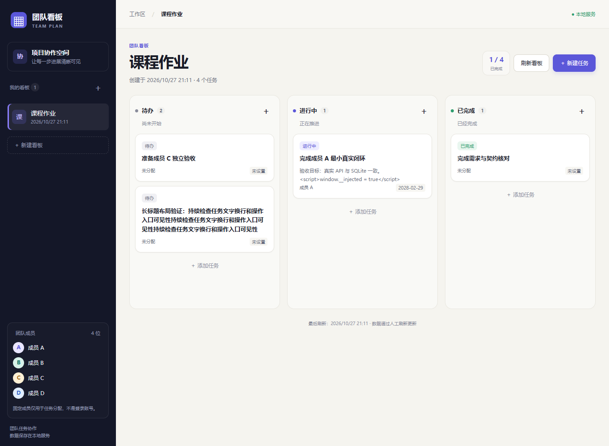

# 团队任务协作看板

“AI生成式软件”课程的四人协作项目，目标是实现轻量版 Trello：通过多个看板管理任务，展示负责人、截止日期和完成状态。

项目采用**人定义场景与验收、AI 生成端到端切片、机器回归、人独立复验**的开发方式。分工和进度不看代码行数，而看可运行、可演示的用户结果。

## 当前状态

**S0 已完成；S1 创建与展示已实现，待成员 C 独立验收及合并。**

仓库目前包含：

- 已评审的产品契约、架构与验证清单；
- 原型截图和样式参考；
- Express 后端骨架、健康检查、请求与安全边界；
- SQLite P0 表、固定成员种子、连续迁移编号与校验和；
- 看板创建/读取、成员读取、任务创建/读取的真实 API；
- Vue 页面、shared 契约、三列与详情、表单及错误恢复；
- 后端隔离测试、前端测试与真实 Edge 浏览器回归。

现在可运行“建看板 → 建任务 → 三列/详情 → 刷新与重启持久化”。编辑、删除、状态变更与选做功能尚未实现，完整 P0 仍需 S2～S4。CHECK 清单尚未经过成员 C 的独立确认，不把自动化结果等同团队验收。见 [S1 验证报告](docs/s1-verification.md)。

## 获取项目

```sh
git clone https://github.com/233zsq/teams-task-board.git
cd teams-task-board
```

## 本地运行

本轮验证环境：Windows、Node.js **24.18.0**、npm **11.16.0**。前端依赖要求较新的 Node；根 `engines` 为 `^22.22.2 || >=24.15.0`。依赖以根锁文件为准；历史 Node 18 记录仅属于 S0 后端，不代表当前前端兼容。

在仓库根目录使用 PowerShell：

```powershell
npm ci
# 默认配置即可本机运行；需要自定义时，仅首次复制，勿覆盖已有配置
if (-not (Test-Path .env)) { Copy-Item .env.example .env }
npm run db:init
npm run dev:backend
```

另开终端运行前端：

```powershell
npm run dev:frontend
```

打开 <http://127.0.0.1:5173>。Vite 将 `/api` 代理至 `127.0.0.1:3000`，数据写入配置的真实 SQLite。检查健康接口：

```powershell
curl.exe http://127.0.0.1:3000/api/v1/health
```

- `npm run db:init` 只应用待执行迁移并幂等写入四名固定成员，可重复执行，不删除看板或任务。
- 数据库未初始化、结构不兼容或配置无效时，服务明确失败，不回退到内存库或另一个空库。
- 配置键以 `.env.example` 为入口；`.env` 和本地数据库不提交仓库。

验证及构建命令：

```powershell
npm run test:backend
npm run test:frontend
npm run typecheck
npm run build:backend
npm run build:frontend
npm run test:e2e
```

`test:e2e` 默认使用本机 Microsoft Edge，独占测试端口 3101/5174；每例使用独立临时 SQLite，结束后关闭测试进程并清理数据库。可设置 `PLAYWRIGHT_CHANNEL=chrome` 使用已安装的 Chrome；其他平台可设置 `PLAYWRIGHT_CHANNEL=chromium` 并安装 Playwright Chromium。测试不会连接开发数据库，也不复用已有端口服务。

共享包在根 dev/test/build 命令开始前构建；修改 shared 后重新运行相应命令，使前后端读取新产物。后端生产构建可用 `npm start -w backend` 启动；S1 仍使用 Vite 提供页面，Express 静态同源部署由 S4 实施。

`npm run dev:frontend:demo` 是单独的内存夹具预览，页面会显示提示；它不持久化，不作为 S1 验收入口。日常运行请用 `dev:frontend`。

## S1 实际运行效果



[成员 A 计划](docs/member-a-plan.md) · [操作与交接手册](docs/s1-handoff.md) · [验证与审查记录](docs/s1-verification.md)

## 预期效果


原型用于给 AI 与评审提供视觉和交互目标，不代表功能已经运行。更多场景见 [prototype/screenshots](prototype/screenshots/)，样式参考 [global.css](prototype/styles/global.css)。

## 文档导航

| 目的 | 入口 |
| --- | --- |
| 了解分工、当前切片和完成门禁 | [tasks.md](tasks.md) |
| 查看用户场景、业务规则、字段和 API 契约 | [spec.md](spec.md) |
| 理解实际架构、关键约束与技术决策 | [architecture.md](architecture.md) |
| 执行切片验收与最终复演 | [checklist.md](checklist.md) |
| 给编码代理提供仓库操作约束 | [AGENTS.md](AGENTS.md) |
| 查看 AI 输入、首次结果、人工修正与验证证据 | [ai-log.md](ai-log.md) |

课程补充材料：[飞书文档](https://hypersmart.feishu.cn/wiki/IK4YwAvp6i3X9hk5Ih1csuTjn9g)。外部材料的具体要求以课程方发布为准。

## 切片分工

| 切片 | 用户结果 | 主驾 | 独立验收 |
| --- | --- | --- | --- |
| S1 | 建看板、建任务、三列/详情、真实持久化 | A | C |
| S2 | 多看板切换、直接链接、空态与加载恢复 | B | D |
| S3 | 编辑、删除、状态、日期、键盘和窄屏操作 | C | A |
| S4 | 双浏览器、异常、安全、备份恢复与交付加固 | D | B |
| S5 | 核心通过后选择一个完整扩展 | 待定 | 非主驾成员 |

S1 后，S2 与 S3 可并行。每个切片同时交付所需的 UI、API、数据变更、测试和真实演示，不再按技术层等待联调。完整范围与旧任务映射见 [tasks.md](tasks.md)。

## 产品边界

- **P0 必做：** 看板创建/查看/切换；任务增删改查、负责人、截止日期、状态与逾期；SQLite 持久化、错误恢复、多浏览器人工刷新、本地交付。
- **P1 选做：** 优先级、筛选、拖拽与排序。
- **P2 选做：** 带完整访问控制的只读分享。

核心版使用预置成员 A～D，不包含登录、成员管理、实时同步或自动冲突合并。任务状态为 `todo`、`doing`、`done`，允许任意双向流转。完整规则以 [spec.md](spec.md) 为准。

## 每轮 AI 开发留下什么

1. 人事先确定的 REQ、CHECK 和失败例子；
2. 给 AI 的相关代码、原型、约束与代表性提示；
3. 首次生成结果及真实失败；
4. 人工采用、拒绝和修正的理由；
5. 自动化、真实浏览器与独立验收证据。

记录入口为 [ai-log.md](ai-log.md)。不保存全部聊天，不补造历史记录，不让 AI 自己宣布验收通过。

## 协作约定

- 一个短分支交付一个用户切片或一个可复现缺陷修复，`main` 保持可启动。
- PR 关联切片/REQ/CHECK，包含实际测试、真实操作、契约或迁移影响和 AI 记录。
- 业务或 API 变化在同一 PR 更新 spec、实现和验证；数据库只新增后续迁移，不改写已应用版本。
- 提交标题使用`类型: 中文说明`，例如`feat: 打通看板与任务创建闭环`。
