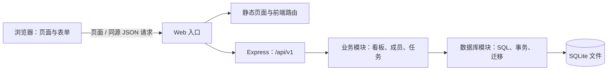
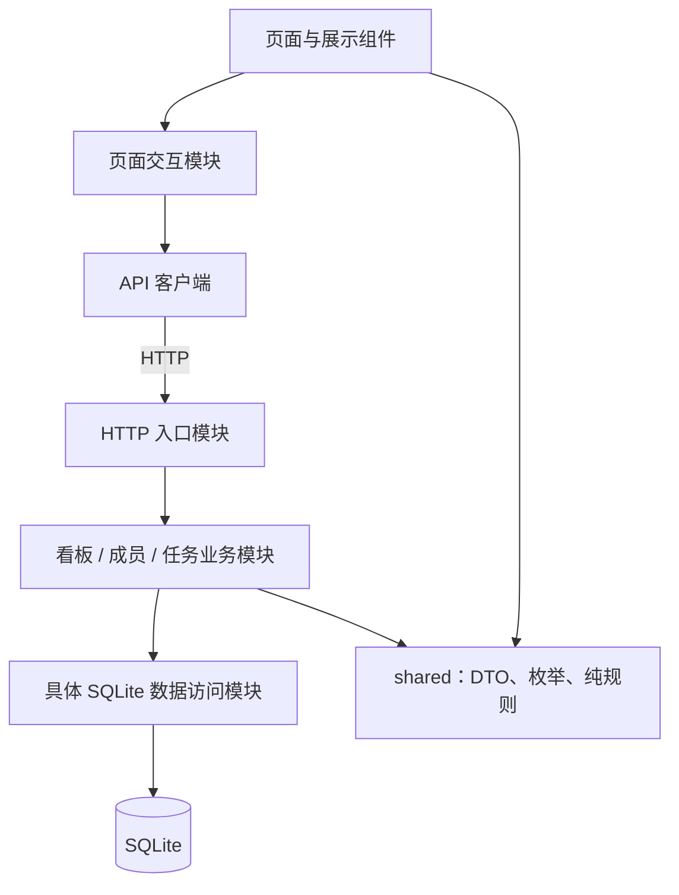
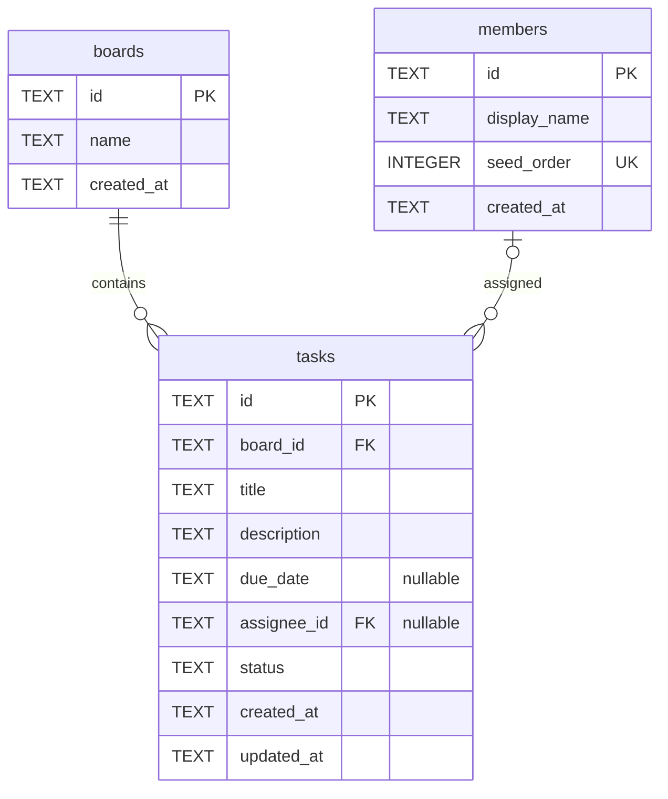
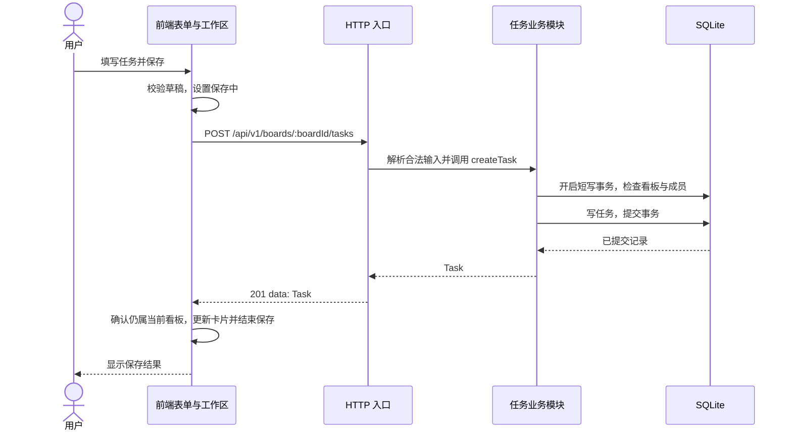

# 团队任务协作看板：系统架构设计

版本：0.5（评审确认稿）｜日期：2026-10-21｜状态：P0 契约已由四人确认；TASK-002/005 之后，业务 API、前端与回归脚本均已实现（2026-10-27，见 verification/）

依据：[功能规格](spec.md)｜验证依据：[验证清单](checklist.md)｜项目入口：[README](README.md)

v0.5 变更：按 2026-10-21 评审修订——补充 Host 校验与安全响应头、同步驱动阻塞与健康探针超时、迁移编号与校验和、JSON 与控制字符边界、错误文案所有权、备份恢复与演示重置；改写 D-03、D-12、D-15，新增 D-18～D-27；新增 §6.5、§15。冻结基线升级为 spec v0.4。

v0.4 记录：新增第 14 节「M1 冻结决议（TASK-001 记录）」，登记 P0 字段、默认值、错误码、JSON 示例的基线索引、请求边界、配置与运行时约束、待确认项及未采纳备选。

本文说明系统如何组织、模块如何协作，以及数据如何保存和恢复，不涉及人员分工或工作量安排。仓库目前已包含 TASK-002 后端骨架与 TASK-005 数据库迁移/种子，以下其余目录、模块、配置和运行方式仍为设计，不代表已经实现。业务范围、字段、枚举、状态码和优先级沿用 spec.md；本文新增的技术选择属于设计建议，不构成新的课程硬性要求。第 14 节是 TASK-001 的冻结记录：其中对实施有约束力，但涉及业务字段、默认值、错误码与 JSON 示例的条目只做索引，权威文本仍是 spec.md；原先标为契约补丁的边界已并入 spec v0.4 第 4、9 节，14.3 保留决议索引与复核状态。除第 14 节冻结项外，目录、模块、配置和运行方式仍为设计，不代表已经实现。


## 1. 架构目标与约束

核心目标是支持“建看板 → 建任务 → 指定负责人/日期 → 修改状态 → 刷新和重启后可查看”的完整链路，并让业务规则集中、故障可定位、测试可复现。

| 约束 | 架构取舍 |
| --- | --- |
| 本地运行和课程演示优先 | 一个后端进程、一份 SQLite 文件；构建后同源提供页面和 API |
| 核心功能优先 | P0 不依赖优先级、筛选、拖拽或分享；扩展采用增量迁移和显式功能开关 |
| 多浏览器访问同一份数据 | 数据库是持久化来源；浏览器保留快照，通过刷新重新读取 |
| 没有登录体系 | P0 不区分浏览器身份；任务负责人只是业务关联，不是访问权限 |
| 不要求实时协作 | 不使用 WebSocket、SSE、后台轮询或自动冲突合并 |
| 控制实现复杂度 | 不拆微服务，不使用 Redis、消息队列、容器编排或云数据库 |
| 规模按课程演示准备 | 暂按 10 看板、合计 200 任务、4 浏览器会话观察；不据此承诺生产容量 |

本文使用 Module（模块）表示具有明确 Interface（接口）和 Implementation（实现）的代码集合。Interface 不仅描述参数，也包括默认值、错误和调用条件；Seam 表示可替换依赖的位置，Adapter 表示在该位置提供实际能力的实现。只在实际需要替换时设置 Seam，例如真实时钟与测试时钟、真实网络与故障夹具；不为每一层增加一套通用框架。

## 2. 技术方案与总体结构

### 2.1 建议技术选择

| 部分 | 建议方案 | 理由与限制 |
| --- | --- | --- |
| 页面 | Vue 3 + TypeScript + Vite | 适合组件、表单和路由；浏览器只处理显示与交互，不直接访问数据库 |
| HTTP 后端 | Node.js + Express；新增建议：后端也使用 TypeScript | 保持 DTO 和业务类型一致；TypeScript 类型不能代替运行时校验 |
| 持久化 | SQLite，参数化 SQL，无 ORM | 部署简单，约束和事务可直接验证；单实例、短事务，不适合大量并发写 |
| 仓库组织 | 单仓库，frontend/backend/shared 三个包，建议 npm workspaces | 共享契约和纯规则；不分别发布三个服务或引入独立部署流程 |
| 前端状态 | Vue 响应式状态和页面级组合逻辑 | 当前规模不引入额外全局状态框架；服务端结果与表单草稿分离 |

实际 Node.js、包管理器和依赖版本需在 M1 验证后锁定。SQLite 驱动集中在数据库模块内选择：在课程 Windows/Node 环境验证安装、读写、外键、事务和锁等待后固定版本；不在文档阶段宣称某个尚未安装的驱动已经兼容。仓库组织、语言与框架基线及驱动可替换点已由第 14 节 D-11 冻结；实际小版本仍以课程机验证结果为准，验证后写入 README 与 `engines`。TASK-002 在当前机器以 Node 18.17.1 验证（36 项测试通过）；`engines` 暂写 `>=18.17`，是否升级到 22 LTS 由 M1 课程机复核决定。

`shared` 的构建顺序对开发效率有直接影响：开发时需要先构建或监听 `shared` 产物，再启动前后端；否则后端和前端会读到旧契约。M1 用根脚本并行启动 `shared` 监听、后端和前端，并用一次“修改共享类型后两端都看到新值”的检查确认链路，不采用依赖工具差异的源码直连方案。

### 2.2 运行视图



开发时 Web 入口是 Vite，`/api` 代理到 Express；构建演示时 Web 入口就是 Express，由同一进程提供静态构建和 API。数据库文件只由后端访问，不放在前端静态目录，也不通过文件下载接口暴露。

### 2.3 模块依赖方向



- 页面不拼 SQL，后端路由不持有页面状态，数据库模块不引用 Express 请求/响应对象。
- shared 仅包含可在浏览器与 Node.js 使用的类型和纯函数，不导入 Vue、Express、文件系统、密钥或数据库连接。
- API 请求响应由显式 DTO 表达，不直接序列化数据库行；SQL 的 snake_case 只存在于数据库模块内，外部统一 camelCase。
- 事务由业务模块决定何时开始和结束，连接和 SQL 执行由数据库模块实现；不让多个路由自行组合事务。
- 数据访问使用具体模块方法，不建立通用 Repository 基类、插件式容器或一对一转发的多层接口。后端集成测试优先使用临时 SQLite 数据库。

## 3. 建议目录与构建关系

以下目录设计已用于 TASK-002 后端骨架与 TASK-005 数据库迁移；其余模块按任务逐步实现。

```text
team-plan/
  README.md
  spec.md
  architecture.md
  tasks.md
  checklist.md
  package.json                 根工作区与开发/构建/测试调度（待实现）
  package-lock.json            统一锁定依赖（待生成）
  shared/
    src/contracts/            请求、响应、错误与功能开关类型
    src/rules/                枚举、长度、文本与纯日期规则
  frontend/
    src/router/               页面路径和未保存离开确认
    src/pages/                首页、看板页、选做分享页
    src/features/boards/      导航、新建看板、列表状态
    src/features/tasks/       卡片、列、详情、表单、任务操作
    src/api/                  HTTP 客户端和 DTO 处理
    src/styles/               页面适配和公共样式
    tests/                    前端模块测试
  backend/
    src/app.ts                组装 HTTP 应用，测试可直接加载
    src/server.ts             配置、连接、监听与退出
    src/http/                 路由、输入解析、错误和日志
    src/modules/boards/       看板业务操作
    src/modules/members/      预置成员只读操作
    src/modules/tasks/        任务 CRUD、归属和状态规则
    src/db/                   连接、SQL 映射、事务和种子
    migrations/               有序迁移文件
    tests/                    临时 SQLite 与 HTTP 集成测试
  tests/e2e/                  浏览器端到端与演示回归
  data/                       本地数据库，未来必须忽略入库
```

构建顺序：shared → frontend/backend。shared 输出运行时代码及类型声明，避免后端直接执行未编译 TypeScript。开发时先准备 shared 并监听其变动，再启动双端；根脚本负责并行监听与启动，具体命令实施后写入 README，目前不提供不存在的启动命令。M1 需记录一次“修改 shared 后前后端都生效”的验证结果，避免只在本机隐式成功。

后端的 `app` 与 `server` 分开，使 HTTP 集成测试能够传入测试数据库、测试时钟和配置，不必启动演示实例。选做模块只在选择后增加相应源码、迁移和测试，不预先创建空框架。

## 4. 前端架构

### 4.1 页面与模块 Interface

| 模块 | 对外 Interface 与职责 | 内部维护的行为 |
| --- | --- | --- |
| 应用入口 | 读取健康状态/功能开关，进入首页或指定看板 | 健康 503 显示阻断提示和重试，不渲染空工作区；开关与前端构建不一致时提示刷新；P2 编辑密钥入口 |
| 看板导航 | 展示列表、创建、选择看板 | 名称校验、默认选中、当前 URL 和空状态 |
| 看板工作区 | 加载/刷新当前看板，组织三列和任务操作 | 请求生命周期、成员映射、过期响应隔离 |
| 任务展示 | 接收 Task 和成员名称映射，发出查看/编辑/改状态/删除意图 | 长文本、状态文字、日期显示；不直接发 HTTP |
| 任务表单 | 接收初始值，输出合法草稿或取消 | 独立草稿、dirty、字段错误、保存中状态 |
| API 客户端 | 接收领域请求，返回 DTO 或统一错误 | JSON、10 秒超时、取消读取、204、错误解析；不自动重放写请求 |
| 纯业务规则 | 文本规范化、枚举/长度/日期校验、逾期判断 | 无网络与系统时钟副作用，时间作为参数传入 |

负责人通过 `/members` 获取的 ID 映射显示名；任务只保存 `assigneeId`，不维护一份可编辑“成员名称副本”。四条预置业务成员与浏览器身份无关。

### 4.2 状态模型

前端区分三类状态：

1. **服务器快照**：看板列表、成员列表、当前看板与任务。每组资源具有 `idle / loading / ready / error` 状态和错误信息，不能把读失败写成空数组并显示“没有任务”。
2. **交互状态**：当前 boardId、打开的任务、表单草稿、dirty、saving、删除确认。编辑草稿是快照副本，取消不会改列表。
3. **派生状态**：三列分组、负责人显示名、逾期标记；由已加载数据计算，不写回数据库。

P0 不将任务存入 localStorage，不支持离线编辑，也不在浏览器模拟数据库。P2 仅维护密钥允许存当前标签页 sessionStorage，任务内容仍由服务端提供。

### 4.3 加载和切换看板

1. 首页读取看板列表和成员；有看板时默认选择 createdAt/id 升序的第一项；新建后主动选中新板。
2. 指定看板路由先验证/加载该看板，再读取其任务；不存在时显示 404，不自动切到另一个有效看板。
3. 每次看板加载建立新的请求序号并绑定 boardId。切换时清除旧任务、旧详情和旧错误，尽力取消旧的读取请求；清空后显示列骨架和加载状态，不显示成空态。
4. 响应返回时同时检查请求序号与 boardId；即使取消未能阻止响应，旧数据也不得覆盖当前工作区。
5. “刷新看板”重新读成员、看板列表、当前看板与任务；当前列表/成员失败时分别提示，不能把旧成员 ID 映射成“未分配”。表单依赖成员读取成功才可保存。
6. 刷新成功后更新“最后刷新时间”，刷新中禁用重复刷新；刷新失败保留当前数据并标记“可能已过期”，不显示为空。

取消读取只影响浏览器等待，不代表服务器撤销操作。写请求已经发出后，不因切换页面就假定数据库没有变化。

### 4.4 新建、编辑、状态与删除

- P0 使用确认成功后更新页面的方式：POST/PUT 成功后以服务器 Task 替换/加入当前快照，删除在 204 后移除；避免网络失败时出现虚假成功。
- 编辑前可通过任务详情接口读取最新快照，再建立完整草稿。若最新快照的 `updatedAt` 与列表快照不同，保存前提示“可能覆盖他人修改”，用户可取消或继续；不引入版本锁。PUT 始终提交 title、description、dueDate、assigneeId、status；状态按钮也从当前 Task 构造完整 PUT，不另加状态专用接口。
- 同一个表单/任务正在保存时禁用重复提交和冲突操作；等待期间不允许再次切换或关闭该编辑流程。超时后恢复操作，但必须提示结果可能需要刷新查证。
- 本浏览器保存成功不保证其他浏览器立即看到；其他浏览器仍需刷新。前端也不承诺自动合并旧表单与新数据。
- 422 显示字段错误并保留输入；500/503/网络失败保留草稿；404 提示任务已不存在；取消编辑丢弃草稿。
- 关闭、切板或刷新遇到未保存内容时先确认，取消则保持原界面。浏览器整页离开使用原生离开确认能力，不承诺自定义对话框文本。
- 新建请求若服务器已提交但响应丢失，重新 POST 可能重复创建；不自动重试，先由用户刷新核实。
- 新建看板同样加提交锁：请求进行中禁用重复提交和看板切换，成功后选中新板；避免“创建成功”与用户随后切板互相覆盖选择。
- 应用启动读取健康检查；503 时显示阻断提示和重试，不进入空白工作区。运行期渲染异常或未处理 Promise 由全局错误处理显示可恢复错误页，保留刷新入口。
- 前端按 code 映射主提示文案，字段错误显示服务端固定短文案；不把 message 当作稳定契约，也不回显用户输入。
- P1 筛选启用后，写入成功须重新查询当前筛选结果；不再匹配的任务移出并提示。此行为由工作区协调，不散落到各个卡片中。

## 5. 后端架构

### 5.1 HTTP 处理顺序

1. 启动时加载并验证配置、数据库连接、迁移版本（含编号与校验和）和功能开关。
2. 请求进入后记录方法、脱敏路径、状态与耗时，不记录正文、维护密钥或分享 token。
3. 校验 Host 头；不在允许列表返回 403 `FORBIDDEN`，不进入业务查询，也不把请求体写入日志。
4. 提供健康检查；P2 启用时提供独立公开分享读取及写方法 405 处理。
5. 私有 `/api/v1` 请求在 P2 启用时先验证维护密钥，再进入业务查询；P0 不启用该鉴别。
6. 对有正文的写请求检查 JSON 媒体类型、32 KiB 上限，解析结构，拒绝未知字段及非法路径/查询参数；顺序与优先级见第 14 节 D-03：未匹配的 `/api` 路径/方法先返回 404，匹配到的写路由内部依次为 415 → 413 → 400 → 422。
7. 路由调用业务模块；业务模块完成关联检查、默认值和事务，返回领域结果。
8. HTTP 层包装成功 DTO 或映射错误；未匹配 `/api` 路径返回 JSON 404，不进入 SPA 回退。

写路由统一通过 `writeRoute(handler)` 组合媒体守卫、32 KiB 解析和错误映射；新增写路由不得绕过该入口，测试需覆盖“所有写路由都经过守卫”。

API 响应统一 `Cache-Control: no-store`，并设置 `X-Content-Type-Options: nosniff` 和 CSP `frame-ancestors`（或 `X-Frame-Options`）基线。未匹配路径带正文时返回 404 并设置 `Connection: close`，避免未读正文破坏 keep-alive 复用。Node HTTP 层错误（非法请求行、超大 header、重复 `Content-Length`）发生在 Express 之前，`server` 绑定 `clientError` 时尽量返回 400 JSON，不能返回时就关闭连接；该边界不作为统一 JSON 契约的一部分验收。

公开分享页的 HTML 和前端静态资源不要求维护密钥；公开数据只能由专门的分享读取接口获得。私有数据读取和写入使用同一维护密钥保护，不能只保护按钮或写路由。

### 5.2 业务模块 Interface

下表为操作约定，不是本次交付的业务代码。领域方法不接收 Express 对象。

| 模块 | 操作 | 对调用方保证 |
| --- | --- | --- |
| 看板 | `listBoards`、`getBoard(boardId)`、`createBoard(input)` | 稳定排序、名称规范化、ID/时间由服务端生成；同名允许；不存在为 NOT_FOUND |
| 成员 | `listMembers` | 只读四成员，按 seedOrder 排序；不提供新增/删除或登录方法 |
| 任务 | `listTasks(boardId, filters)`、`getTask(boardId, taskId)` | 看板不存在为 NOT_FOUND；存在但无任务返回空数组；任务归属共同校验 |
| 任务 | `createTask(boardId, input)`、`updateTask(boardId, taskId, input)` | 默认值、五字段全量更新、成员存在性、状态/日期规则；提交后才返回结果 |
| 任务 | `deleteTask(boardId, taskId)` | 只删除指定板内任务；不存在或跨板为 NOT_FOUND；不隐式恢复或重新创建 |
| 数据库 | 按业务需要的查询/写入方法及 `withWriteTransaction` | 参数化 SQL、行到 DTO 映射、提交/回滚、连接错误；不向页面或 HTTP 暴露连接 |

P0 的 filters 只允许空条件；选择 REQ-017 后才接受其白名单条件。选做排序增加一个 `moveTask` 操作；分享新增生成、撤销和公开读取三个操作，不把可选操作伪装成核心依赖。

### 5.3 规则集中位置

| 规则 | 主要位置 | 其他层职责 |
| --- | --- | --- |
| 字段类型、未知键、请求体大小、路径格式 | HTTP 输入解析 | 前端只负责更早反馈，不能代替服务端检查 |
| 文本 trim、码点长度、控制字符与零宽/双向字符、状态枚举、真实日期 | shared 纯规则，后端强制调用 | 日期用纯字符串和自实现日历，不用 `Date` 解析；数据库再约束可表达的部分 |
| JSON 顶层结构、重复键与原型相关键 | HTTP 输入解析 | 只接受对象；按白名单取值，不对请求体做对象合并 |
| Host、Origin 与安全响应头 | HTTP 入口（Host 白名单、统一响应头） | 前端不参与；代理与同源部署不改变白名单 |
| boardId/taskId 归属、成员存在性、默认值 | 业务模块 | 数据库提供匹配查询及外键保护 |
| SQL、snake_case 映射、索引使用 | 数据库模块 | 上层不拼 SQL，不接受任意客户端列名 |
| 迁移编号与校验和 | 数据库模块启动检查 | 不修改已应用迁移；缺号、重号或不一致即失败 |
| 表单、空态、焦点、过期响应和错误提示 | 前端交互模块 | 后端仅返回确定的领域结果/错误；文案按 code 映射 |
| “今天”与 ID 生成 | 入口注入时钟和 ID 生成能力 | 纯规则和测试接收确定值，不修改系统时钟 |

业务模块通过初始化参数获得数据库、时钟和 ID 生成能力；不引入依赖注入框架。数据库测试使用真实约束的临时 SQLite，避免内存对象替身漏掉外键和 SQL 行为。

## 6. 数据模型与持久化

### 6.1 核心关系



此外有 `schema_migrations(version, checksum, applied_at)` 记录已执行迁移。一个任务必须属于一个看板，可关联零或一个成员；成员全局预置，无看板成员关系或用户表。

完整类型、长度、主外键、CHECK 和索引以 [spec.md 第 8 节](spec.md#8-数据库初步设计) 为准。P0 必要索引为任务的 `(board_id, created_at, id)`、`(assignee_id)` 及成员 seed_order 唯一索引，主键自带对应索引。

### 6.2 约束分层

- API：Unicode 首尾空白、码点长度、NUL/控制字符、真实日历、UUID、字段白名单和业务关联。
- 数据库：主键、必填、外键、文本长度、普通空格 trim、状态枚举及日期数字格式。真实日历与完整 Unicode 空白不是数据库 CHECK 的承诺。
- 每个连接启用外键并设置 5000 ms 锁等待；初始化连接和测试连接都必须采用相同约束设置。
- 任务定位在 SQL 查询和写入中同时包含 board_id 与 id；不先按 taskId 返回数据再依赖前端过滤。
- 日期保存 `YYYY-MM-DD` 或 null；时间戳保存 UTC RFC 3339 毫秒文本。状态只用 todo/doing/done，不存中文枚举。

### 6.3 事务与并发

写事务在业务模块内覆盖“验证当前关联 → 读取当前记录 → 写入 → 必要的排序调整”。事务内不做 HTTP 请求或等待用户操作；需要多条 SQL 时共同提交或共同回滚。采用短写事务，避免多个模块嵌套开启事务；驱动锁忙错误映射为 503。

P0 全量 PUT 采用后提交成功的更新覆盖先前更新，无版本号、If-Match 或自动合并。`updatedAt` 不作为锁；删除后的 PUT 返回 404。顺序由实际事务提交决定，不能按浏览器点击时间判断。

同一浏览器任务更新成功后展示返回值；其他会话持有旧快照，刷新后取得当前值。跨多次 GET 的“刷新看板”不是全数据库原子快照：并发编辑可能发生在这些请求之间，允许再次刷新，不新增聚合快照接口。

### 6.4 初始化、升级与备份

- 数据库路径在启动时解析为固定绝对路径；相对路径以项目根目录为基准，不随启动 shell 目录改变。持久化文件缺失时的建库由显式初始化流程完成，正常启动不能静默创建替代空库。
- 初始化/迁移命令负责空库建表、迁移登记和四成员固定 ID 的幂等种子。迁移版本已执行则跳过，不清空已有任务。
- 迁移文件使用四位定长编号（`0001_…`）顺序执行；`schema_migrations` 同时记录版本和文件 SHA-256。缺号、重号、未知更高版本、校验和不一致均启动失败，不自动修复。
- 服务启动只核对结构版本和可访问性，不在每次 API 请求或浏览器访问时迁移。缺迁移、未知更高版本、路径不可写时明确失败。
- 迁移按交付版本有序执行，每个迁移与其登记共同提交。驱动/SQLite 行为需以临时数据库集成测试确认；不修改已经应用的历史迁移。
- 升级前停止后端并关闭所有数据库连接后复制备份；默认不启用 WAL。若将来采用 WAL，必须同步修订备份方案，不能热复制单个主文件。
- 恢复时停服，将备份恢复到配置路径，再用兼容该结构版本的应用启动并核对数据。恢复前核对备份完整性、迁移编号与校验和；恢复失败不自动降级、删库或改用空库。
- 数据库、备份、日志和 .env 不入库；演示数据单独准备。演示数据重置是独立命令，只清理演示看板与任务，默认要求显式确认，普通初始化没有破坏性清库行为。

### 6.5 并发、阻塞与超时

- `better-sqlite3` 为同步驱动：一次写事务或锁等待会占用事件循环，等待期间健康检查和其他读请求一起排队；`busy_timeout=5000` 是进程级的最坏等待上限，不是单请求隔离。
- 缓解方式：事务内只做必要 SQL、不在事务中等待 HTTP 或用户输入；健康探针使用独立连接并把等待时间降到 200 ms 左右；锁等待失败统一映射 503。
- 服务端不设应用层请求超时，客户端 10 秒超时只结束本地等待；已发出的写请求可能已经提交，必须人工刷新查证，不自动重放。
- 健康探针同时核对 `schema_migrations` 的版本与校验和；未初始化时启动失败，运行期结构不一致返回 503。
- 这些是演示规模的已知限制，不承诺并发写吞吐，也不据此声称生产可用。

## 7. 接口契约与错误流

完整路由与 JSON 示例以 [spec.md 第 9 节](spec.md#9-api-契约) 为准；本文不建立第二套不同字段的接口规范。

| 接口组 | 路径 | 架构约束 |
| --- | --- | --- |
| 健康 | `/api/v1/health` | 检查可读性并返回功能开关，不暴露路径/秘密 |
| 成员 | `/api/v1/members` | 只读列表，非账号或成员管理接口 |
| 看板 | `/api/v1/boards`、`/api/v1/boards/:boardId` | 创建/列表/详情；无看板编辑或删除接口 |
| 任务 | `/api/v1/boards/:boardId/tasks` 及 `/:taskId` | GET/POST/PUT/DELETE；所有单任务操作均验证归属 |
| 排序 P1 | 任务路径后加 `/move` | 只接受目标状态和锚点，后端决定实际序号 |
| 分享 P2 | `/api/v1/boards/:boardId/share`、`/api/v1/shares/:token` | 私有管理与公开读取分开 |

统一成功格式 `{"data": ...}`；删除 204 无正文，客户端不能继续对其调用 JSON 解析。错误为 `{"error":{"code":"...","message":"...","fields":{...}}}`，非字段错误省略 fields。

| 情况 | HTTP / code | 前端处理 |
| --- | --- | --- |
| 损坏 JSON、未知输入、非法路径格式 | 400 / BAD_REQUEST | 提示请求不符合契约，记录可定位信息 |
| P2 私有访问缺少或错误密钥 | 401 / EDITOR_KEY_REQUIRED | 清除失效维护密钥，提示重新输入 |
| Host 头不在允许列表 | 403 / FORBIDDEN | 不读取业务数据，提示网络/地址异常；属防 DNS rebinding 边界 |
| 不存在或跨看板资源 | 404 / NOT_FOUND | 显示不存在、提供返回/刷新，不创建替代记录 |
| P2 公开分享写方法 | 405 / METHOD_NOT_ALLOWED | 保持只读，数据库不变 |
| 正文超过 32 KiB / 非 JSON 正文 | 413 / PAYLOAD_TOO_LARGE；415 / UNSUPPORTED_MEDIA_TYPE | 提示不能提交，不重试原请求 |
| 值、日期、枚举、必填或关联非法 | 422 / VALIDATION_ERROR | 显示字段错误，保留草稿 |
| 未预期错误 | 500 / INTERNAL_ERROR | 中文通用提示，不泄露堆栈或 SQL |
| 数据库不可用、锁等待超时 | 503 / SERVICE_UNAVAILABLE | 提供人工重试/查证入口，不自动重放写请求 |

客户端超时属于本地网络错误，不伪造成某个服务器 HTTP 状态码。未知私有方法/路径统一 404；未匹配路径带正文时返回 404 并关闭连接；公开分享 token 的格式错误、不存在和撤销统一 404。API 响应统一 `Cache-Control: no-store` 并带 `nosniff`、CSP `frame-ancestors` 基线；Node HTTP 层错误（非法请求行、超大 header）不属于统一 JSON 契约，验收时单独记录。

## 8. 关键运行链路

### 8.1 创建任务



失败分支：事务失败回滚后返回错误；前端保留输入。提交成功但响应丢失时不自动 POST，提示先刷新查证。服务端收到请求不等于创建成功，只有提交后才能返回 201。

### 8.2 双浏览器编辑

1. 两个浏览器读取任务版本 X，分别形成独立草稿。
2. 第一个浏览器完整 PUT 成功，数据库变为 Y。
3. 第二个浏览器仍基于 X 完整 PUT 成功，数据库变为 Z；即使只手工改了描述，其余字段仍可能覆盖 Y。
4. 第一个浏览器刷新后读到 Z。若第二次操作发生在删除之后，则返回 404。

这是既定 P0 行为，不添加版本锁。若课程以后要求冲突检测，需新增需求、修改请求契约和验证项。

### 8.3 日期显示

入口从时钟按 Asia/Shanghai 取得业务日期，再把“今天”作为参数传入共享纯规则，比较标准日期字符串。`dueDate != null && dueDate < 今天 && status != done` 才逾期。页面加载、刷新及状态保存后重新计算；不使用 UTC 午夜转换日期，也不要求后台计时刷新。测试传固定时钟覆盖午夜、闰年和不同设备默认时区。

## 9. 选做功能的扩展位置

### 9.1 优先级与筛选（P1）

- REQ-016 增加 priority 列、默认 medium 和 low/medium/high CHECK；共享 DTO、表单、卡片及后端输入规则同时扩展。
- REQ-017 依赖 REQ-016，扩展 listTasks 的白名单条件：assigneeId、dueFrom、dueTo、priority；WHERE 由固定模板和绑定值组成，不接受客户端 SQL 或列名。
- 组合条件为 AND，日期包含端点；任一日期条件排除 null 日期；unassigned 对应 assignee_id IS NULL。
- 当前筛选属于页面交互状态，切换看板清空；查询失败与零结果分别显示。筛选开启时禁用拖拽，避免对隐藏任务位置产生歧义。

### 9.2 拖拽与顺序（P1）

- REQ-018 独立增加 sort_order 与索引。旧任务按每板每状态的 created_at/id 回填 0～n-1。
- moveTask 接收 boardId、taskId、targetStatus、beforeTaskId；后两字段均必需，beforeTaskId 可为 null 表示末尾。客户端不直接提交 sortOrder。
- 同一事务校验任务、目标状态和锚点，移除原位置、插入目标位置，将源/目标列重新编号后提交；同列只重排一列。
- 跨板/不存在锚点为 404；锚点为自身或不属于目标状态为 422。响应返回当前看板完整已排序任务数组，前端以其更新。
- 创建及普通改状态时追加目标列尾部，未改变状态的普通编辑保持顺序；删除后压紧原列序号。这些规则集中在任务业务模块，不只在拖拽路由生效。
- 并发 move 在事务内读取最新顺序后应用，按提交顺序生效；前端失败时重新读取服务端数据恢复，不保留虚假的拖动结果。

### 9.3 只读分享与维护密钥（P2）

REQ-019 同时包含私有访问保护、分享管理和公开读取，缺一不可：

1. 启用前要求 `EDITOR_KEY`，至少由 32 个随机字节生成；服务端只校验解码后不少于 32 字节并拒绝明显弱值，不承诺验证随机性。密钥仅在服务端环境配置中保存，不能编进前端构建。
2. 编辑入口人工输入密钥，当前标签页 sessionStorage 保存；API 客户端只向同源私有接口附加 X-Editor-Key。401 清除密钥，不把它放入 URL、日志或公开分享请求。
3. 分享 token 由 32 个随机字节生成 base64url；数据库只存 SHA-256 哈希。一板一个有效 token，换发替换哈希，撤销删除记录。
4. 公开读取只返回指定看板和可展示任务字段，负责人用 assigneeName，不暴露完整成员目录。页面不请求私有看板/成员接口。
5. 服务端保护所有私有读取和写入；分享 token 不具备编辑资格。公开写方法返回 405，不能只隐藏编辑按钮。
6. 分享页面与相关 API 使用 no-store，设置 no-referrer，不加载第三方资源；日志统一把 `/share/:token` 与 `/api/v1/shares/:token` 实际 token 脱敏。
7. 只读页面通过刷新取得最新数据；已打开页面无法追回访客已经看到的内容，撤销保证后续服务端读取失败，不承诺删除访客截图或本地副本。分享页显示“只读”标识和最后加载时间；管理入口提示“撤销不会关闭已打开的页面”。
8. 同一来源连续验证失败达到阈值后暂时拒绝（进程内计数，重启清零），用于降低在线爆破；不承诺防分布式尝试。
9. 密钥轮换需停服并重启；已签发分享 token 不随密钥更换自动失效，必须单独撤销。凭据与 token 在无 TLS 的演示环境中明文传输，仅限可信本机/局域网；跨机演示优先通过反向代理终止 TLS。

P2 仍是可信本地/局域网演示，不等同于用户登录、个人角色或公网安全部署。维护密钥由同一个编辑群体共享，不支持逐人撤权或审计。关闭分享不能继续对外提供旧分享入口并声称私有 API 仍受保护；切回 P0 须收回分享使用场景并恢复回环访问。

### 9.4 功能开关与结构版本

对外开关使用健康响应中的 `priority / filters / ordering / sharing`。P0 全为 false；filters 为 true 时 priority 必须为 true；ordering 和 sharing 不依赖其他选项。

功能开关是启动时确定的交付配置，不提供运行中管理界面。启用某功能前必须完成迁移和实现；开关不能替代迁移。未启用的扩展路由为 404，扩展字段/查询参数按未知输入为 400。健康检查失败时前端显示阻断提示和重试，不进入空白工作区；服务端开关与前端构建不一致时以服务端为准隐藏未支持界面并提示刷新。

关闭功能不删除数据库列或已有数据。数据库模块按已安装迁移维护约束：已存在 priority 在创建时用默认值、普通编辑时保留；已存在 sort_order 在创建/改状态时仍维护合法序号，只关闭外部移动入口和展示。避免关闭功能后插入失败或再次启用时丢失顺序。改变配置需停服核对兼容性、重启并刷新页面，不支持旧前端长期跨版本运行。

## 10. 部署、配置与生命周期

### 10.1 两种本地运行方式

| 场景 | 页面入口 | 数据请求 | 数据存储 |
| --- | --- | --- | --- |
| 开发 | Vite `127.0.0.1:5173` | 相对 `/api/v1`，由 Vite 代理到 `127.0.0.1:3000` | Express 连接配置的 SQLite 文件 |
| 构建演示 | Express `127.0.0.1:3000` | 同源 `/api/v1` | 同一后端持久化目录 |

多个浏览器访问相同入口才能共享数据；多个电脑各自启动后端会产生独立数据，不属于同步。可信局域网演示可显式配置监听地址并由所有浏览器连接同一主机，优先使用构建后的单入口，不新增反向代理基础设施。

### 10.2 建议配置

以下键名是新增设计建议，实际实现和 README 必须保持一致：

| 配置 | 建议默认 | 规则 |
| --- | --- | --- |
| HOST | `127.0.0.1` | 默认回环；局域网监听需明确配置 |
| ALLOWED_HOSTS | 空 | 逗号分隔的允许主机名/IP；为空时只接受 `127.0.0.1`、`localhost`、`[::1]`；监听非回环地址时必须显式配置，否则启动失败 |
| PORT | `3000` | 有效端口，冲突时报错退出 |
| DATABASE_PATH | `data/team-plan.sqlite` | 以项目根目录解析，必须位于非静态目录且可写 |
| NODE_ENV | `development` | 构建演示采用 production；不用于决定业务需求 |
| ENABLE_PRIORITY / ENABLE_FILTERS / ENABLE_ORDERING / ENABLE_SHARING | `0` | 仅接受 0/1，映射健康功能开关；不支持的组合拒绝启动 |
| EDITOR_KEY | 无 | 仅启用分享时必需，不提供默认演示密钥 |

上表键名、默认值与取值规则已由第 14 节 D-10 冻结：新增或改名配置键需先同步本节、README 与 `.env.example`，不得只改实现。

客户端超时 10 秒、请求体 32 KiB、数据库锁等待 5000 ms、业务时区 Asia/Shanghai 均按规格落实，不通过前端自行改变规则。

### 10.3 启停和静态路由

- 启动顺序：校验配置 → 解析固定路径 → 打开数据库/设置连接约束 → 核对迁移编号、校验和与开关 → 组装 HTTP 应用 → 监听端口。任一步失败停止启动，不回退到内存或另一个空库（退出码与提示要求见第 14 节 D-09、D-10、D-12）。
- 启动失败（退出码 1）：配置无效、允许主机缺失、库文件缺失、目录不可写、迁移缺号/重号/校验和不一致、未知更高版本、端口占用。
- 运行期 503：`SQLITE_BUSY`/`SQLITE_LOCKED`、`SQLITE_CANTOPEN`、`SQLITE_READONLY`、`SQLITE_IOERR`、磁盘满、数据库文件在运行中被删除或损坏。其他未预期异常为 500。
- 健康接口在运行中检查数据库可读性；后续数据库异常返回 503，不返回虚假 ok。探针使用独立连接和约 200 ms 等待，避免被写锁长时间阻塞。
- API 路由先于静态文件和 SPA 回退；只有页面导航使用 SPA 回退。`/boards/:boardId`、P2 `/share/:token` 直接刷新应加载页面；未知 `/api` 仍为 JSON 404，带正文时关闭连接。
- 退出时停止接受新请求，完成或终止当前短事务并关闭连接；备份只在停服并确认所有连接关闭后进行。
- 日志为诊断日志，不是操作审计。记录实际错误原因供本地排查，对外响应只给稳定错误码；无服务器栈、数据库路径或正文泄漏。

## 11. 安全与故障处理原则

| 风险 | 处理方式与限制 |
| --- | --- |
| SQL 注入 | 所有值绑定参数，排序字段/枚举来自固定白名单 |
| XSS | 标题和描述按纯文本渲染，不使用 HTML 注入展示用户内容；分享同样执行 |
| 伪造输入 | 后端运行时独立校验，不接受客户端 ID/归属/时间戳/序号 |
| 原型污染 | 请求体顶层必须是对象；危险键按未知字段 400；只做白名单取值，不做对象合并 |
| 未授权跨源浏览器访问 | 开发代理与构建同源，不放宽任意 Origin；CORS 不是身份鉴别，也不能阻止直接 API 客户端 |
| DNS rebinding | 校验 Host 白名单；默认回环；局域网监听必须显式配置允许主机 |
| 明文凭据与 token | 服务无 TLS，`X-Editor-Key` 和分享 token 明文传输；仅限可信本机/局域网，跨机演示优先 TLS 终止 |
| 安全响应头与缓存 | API 统一 no-store + nosniff + CSP frame-ancestors；分享页 CSP 禁第三方与内联；撤销后 404，不依赖缓存 |
| 密钥暴力尝试 | P2 同一来源连续失败后暂时拒绝（进程内计数）；P0 不设通用速率限制，属已知限制 |
| 写请求失败或响应丢失 | 不自动重放；保留输入/卡片，必要时先刷新查证；不承诺创建幂等 |
| 并发覆盖 | 明确完整 PUT 行为并验证；编辑前比对 `updatedAt` 提示可能覆盖，不把它当作锁 |
| 锁竞争 | 短事务、5000 ms 等待、503 和人工恢复；同步驱动会阻塞进程，健康探针使用短等待 |
| 文件/配置泄漏 | 数据库和备份不在静态目录、不入库；密钥和 token 日志脱敏 |
| 误把只读 UI 当权限 | P2 必须验证私有 API 密钥和公开路由只读，不能靠隐藏按钮 |

## 12. 架构验证与需求追踪

以下为未来验证入口，不是通过记录；现有 checklist 全部保持未勾选。

| 架构能力 | 关联需求 | 验证入口 |
| --- | --- | --- |
| 看板/任务模块契约及完整闭环 | REQ-001～REQ-008 | CHECK-001～CHECK-014、CHECK-042 |
| 纯日期和时区规则 | REQ-009 | CHECK-015～CHECK-017 |
| SQLite 约束、归属与持久化 | REQ-010、REQ-014 | CHECK-018～CHECK-020、CHECK-031～CHECK-034 |
| 草稿、错误、刷新和过期响应隔离 | REQ-011、REQ-012 | CHECK-021～CHECK-028 |
| 组件适配及键盘流程 | REQ-013 | CHECK-029、CHECK-030 |
| 错误/安全、同源、配置和健康 | REQ-014 | CHECK-031～CHECK-036 |
| 初始化、构建和真实端到端链路 | REQ-015 | CHECK-037～CHECK-043 |
| 优先级/筛选扩展 | REQ-016、REQ-017 | CHECK-044～CHECK-047、CHECK-057 |
| 顺序事务和拖拽恢复 | REQ-018 | CHECK-048～CHECK-050、CHECK-057 |
| 维护密钥、公开分享及撤销 | REQ-019 | CHECK-051～CHECK-057 |
| 最终文档/交付范围一致 | REQ-015 及所选扩展 | CHECK-058 |

v0.4 没有新增 CHECK 编号，而是扩写既有条目：CHECK-001/006/010/011/012/015/018/021/022/023/025/026/029/030/031/035/036/037/040 已覆盖本次新增的 Host、安全头、JSON 结构、迁移校验和、备份恢复、刷新时间、覆盖提示和删除焦点断言。验证记录必须按扩写后的文本执行，不能用旧版条目代替。

验证分三层：纯规则测试覆盖码点/日期/枚举；临时真实 SQLite + HTTP 测试覆盖约束、归属、状态码和事务；浏览器测试覆盖页面、竞态、双会话、适配和恢复。只为时钟、网络故障等实际变化点提供测试 Adapter，不用一个永远成功的内存数据库替代持久化验收。

必须分别验证新库初始化和旧库升级；SQLite 驱动需额外在实际课程机器验证安装、锁等待与关闭/备份行为。构建通过不代表上述业务或设备环境验收通过。

## 13. 决策摘要与待确认项

| 设计决定 | 采用原因 | 主要代价 |
| --- | --- | --- |
| 单实例单体后端与 SQLite | 本地安装和演示简单，事务集中 | 写竞争和容量上限，不能无成本横向扩展 |
| 后端建议使用 TypeScript，单仓共享纯契约 | 降低双端字段/规则漂移 | 增加共享包构建顺序，仍需运行时校验 |
| 人工刷新、完整 PUT | 不引入实时协作和版本锁 | 浏览器快照可能过期，编辑可能覆盖 |
| 具体数据库模块与临时真库测试 | 约束/SQL 可测，减少空抽象 | 测试要管理临时文件和连接 |
| 可选迁移和显式开关 | P0 独立，扩展可分开交付 | 需要验证已装结构与对外能力的兼容性 |
| 分享包含统一维护密钥保护 | 保证公开链接不能直接编辑 | 不是逐人权限；P2 实现成本高于只读页面 |
| 同步 SQLite + 短事务 + 短探针 | 本地部署简单、事务集中 | 锁等待阻塞进程，不承诺并发写 |
| Host 白名单与安全响应头 | 降低 DNS rebinding 和常见浏览器攻击面 | 局域网演示需显式配置允许主机 |
| 迁移编号与校验和 | 能检测被改写的历史迁移 | 迁移流程和测试略增 |

待确认事项与决策的完整登记见第 14 节：spec 的 `Q-01`～`Q-07` 仍无课程方回复，继续按 `A-01`～`A-09` 假设执行；M1 新增 `Q-08`～`Q-11`（Node/驱动验证、CI 要求、单仓结构、备份与重置）。技术栈、工作区、目录与命令的相关决议已由 D-11、D-16 冻结，v0.5 新增的 D-18～D-27 记录在 14.3；未确认前不得表述为课程硬性要求；若新增业务范围，先修订 spec 与验证清单，不由架构文档悄悄加入核心版本。

## 14. M1 冻结决议（TASK-001 记录）

本节落实 TASK-001 的“冻结 P0 字段、默认值、错误码和 JSON 示例，记录决策”。业务字段、默认值、枚举、错误码与 JSON 示例的权威文本仍是 [spec.md](spec.md) 第 4、8、9 节；本节只做索引并记录实现约束，不复制字段表，也不新增契约边界——需要新增边界时先修订 spec，再同步本节。两者冲突时以 spec.md 为准，并立即修订本节。

### 14.1 冻结规则

| 项 | 约定 |
| --- | --- |
| 冻结基线 | spec.md v0.4（2026-10-21）第 4.1、4.2、4.3、8.1、9.1、9.2 节；由本文件 v0.5 记录 |
| 冻结含义 | P0 开发期内不得单方面改动；改动按“spec → 本节决议 → 受影响 TASK/CHECK → 实现与测试”顺序提交 |
| 编号 | `D-01` 起顺序编号，不复用、不删除；被推翻的决议标记“已废止”并注明替代编号 |
| 假设标签 | 未获课程方确认的内容一律标为“假设”，对应 spec 第 10 节 `A-0x`/`Q-0x`，不得表述为已确认要求 |
| 确认状态 | 2026-10-21 四人（成员 A、B、C、D）逐条复核 D-01～D-27 与 spec v0.4，确认通过、无遗留异议，以本版作为 P0 实施基线；确认记录由成员 A 归档。后续修改仍按 14.1 流程提交 |
| 契约归属 | 原先的契约补丁已并入 spec v0.4；本节只保留决议索引与实现约束，字段、错误码和 JSON 示例以 spec 为准，冲突时立即修订本节 |

### 14.2 冻结基线索引（P0）

| 契约对象 | 冻结内容 | 权威位置 |
| --- | --- | --- |
| 字段、类型、长度、默认值 | `name`、`title`、`description`、`dueDate`、`assigneeId`、`status`；创建默认值与 PUT 全量语义；`__proto__` 等危险键拒绝 | spec §4.2 |
| 枚举 | 状态仅 `todo`/`doing`/`done`，大小写敏感，可任意双向流转 | spec §3 REQ-008 |
| 日期与时间 | 截止日期 `YYYY-MM-DD` 或 null；业务时区 Asia/Shanghai；时间戳 UTC RFC 3339 毫秒；逾期公式；禁止用 `Date` 解析日期；任何成功 PUT 刷新 `updatedAt` | spec §4.3 |
| 文本规则 | trim 后长度、Unicode 码点计数、拒绝 NUL/控制字符与零宽/双向字符、描述保留换行 | spec §4.1 |
| 数据库约束 | P0 三表加 `schema_migrations`（版本 + 校验和）、外键、CHECK、索引 | spec §8.1 |
| 错误码 | 400/401/403/404/405/413/415/422/500/503 与 code、使用场景的映射 | spec §9.1 |
| 请求体与 Host | 顶层必须是对象；重复键按最后值解析；Host 白名单失败 403；安全响应头基线 | spec §9.1 |
| 错误文案归属 | 主提示前端按 code 映射；字段错误用服务端固定短文案；message 仅兜底与日志 | spec §9.1 |
| 成功与错误 JSON 示例 | 看板、成员、任务、健康响应、错误对象 | spec §9.2 |
| 归属与鉴权 | P0 无鉴权；任务操作按 boardId + taskId 定位；跨板统一 404 | spec §3 REQ-010、§9.1 |
| 分页与排序 | P0 不分页；列表按 `createdAt`、`id` 升序稳定返回 | spec §4.3、§9.2 |
| 备份与恢复 | 停服复制、恢复前核对结构版本与校验和、演示重置独立且需确认 | spec §3 REQ-015、§8.1 |

结论：上述条目按 TASK-001 要求冻结为实现与测试的唯一依据，不再处于“可自由调整”状态；确认状态见 14.1。TASK-002 起按此基线编码，测试夹具按示例构造；需要变更时按 14.1 的流程走，不在代码或 PR 描述里另行解释。

### 14.3 冻结决议明细

| 编号 | 决议（已冻结） | 依据 | 落实/复核 |
| --- | --- | --- | --- |
| D-01 | API 基路径 `/api/v1`，健康检查为 `GET /api/v1/health`；P0 不使用 405，未定义的私有方法/路径（含 `POST /api/v1/health`）统一 JSON 404 | REQ-014；spec §9.1、§9.2 | TASK-002 |
| D-02 | 成功为 `{"data":...}`；错误为 `{"error":{"code","message","fields"?}}`，仅字段错误带 `fields`；204 无正文，客户端不解析其 JSON | spec §9.1 | TASK-002、TASK-004 |
| D-03 | 请求处理优先级：**路由匹配先于正文处理**。未匹配的 `/api` 路径或方法一律 404，即使正文超大或非 JSON；未匹配路径带正文时返回 404 并设置 `Connection: close`。匹配到的写路由内部顺序为 415（媒体类型）→ 413（大小）→ 400（JSON 损坏、非对象或未知键）→ 422（字段值）→ 业务 404/403/503 → 500。实现上 `express.json` 与媒体守卫通过 `writeRoute()` 按写路由挂载，不全局挂载，也不允许新增写路由绕过 | REQ-014；spec §9.1、§9.2 | TASK-002（契约测试） |
| D-04 | 空正文的写请求不返回 415：POST、PUT 交给字段校验返回 422，DELETE 正常 204 | spec §9.1 的“有正文的写请求” | TASK-002 |
| D-05 | DELETE 契约为无正文。带正文时：非 `application/json` 返回 415；JSON 正文解析后忽略，正文不得影响业务（不能借此指定 ID 或归属） | spec §9.2 路由表 | TASK-002 |
| D-06 | 未知 JSON 键、客户端提交 `id`/`boardId`/`createdAt`/`updatedAt`/`sortOrder` → 400 `BAD_REQUEST`；类型、长度、日期、枚举、关联值非法 → 422 `VALIDATION_ERROR` | spec §4.2、§9.1；CHECK-034 | TASK-007、TASK-008 |
| D-07 | 查询参数：未知键与重复键 → 400；P0 任务列表不接受任何查询参数；P1 条件下走白名单（`assigneeId`、`dueFrom`、`dueTo`、`priority`） | spec §9.1；REQ-017 | TASK-008、TASK-024 |
| D-08 | 请求体上限 32768 字节：`≤32768` 通过，`≥32769` 返回 413；按原始字节计，不按字符数；写请求只接受 UTF-8 JSON，其他字符集或不被支持的 `Content-Encoding` 返回 415；超限正文不得进入业务层 | REQ-014；spec §9.1（413） | TASK-002 |
| D-09 | 默认监听 `127.0.0.1:3000`；端口占用或不可用即启动失败、退出码 1，不自动改用其他端口、不静默降级 | REQ-014、REQ-015；本文 §10.2/§10.3；CHECK-040 | TASK-002、TASK-019 |
| D-10 | 配置键与默认值按 §10.2 冻结；`ENABLE_*` 只接受 `0`/`1`；`filters=1` 要求 `priority=1`；`sharing=1` 且无有效 `EDITOR_KEY`（解码后 ≥32 字节、非弱值）拒绝启动；`DATABASE_PATH` 相对路径以项目根解析为绝对路径；任一配置错误即退出码 1，提示只给键名与规则、不回显值、不打开或新建数据库、不监听端口。扩展未实现前其开关不得置 1：TASK-002 阶段四项必须全为 0，任一置 1 即拒绝启动并指明对应的实现任务（TASK-022/024/026/028），由各扩展任务实现并验收后逐个放开 | 本文 §10.2/§10.3；spec §8.2 末段 | TASK-002、TASK-019、TASK-028 |
| D-11 | 仓库采用 npm workspaces 单仓加单一根 `package-lock.json`，锁文件不手工拼接；Node 基线为 22 LTS，实际小版本以课程机验证结果写入 README 与 `engines`；后端 TypeScript `strict` 加 Express 5；SQLite 驱动 `better-sqlite3`，验证失败可按 §2.1 改用 `node:sqlite` 且只改 `db/connection.ts`；`shared` 包由 TASK-004 建立，TASK-002 不建空包 | 本文 §2.1、§3 | TASK-002、TASK-003、TASK-004 |
| D-12 | 每个数据库连接显式 `foreign_keys=ON`、`busy_timeout=5000`，默认不启用 WAL；配置的库文件不存在时启动失败并提示执行显式初始化，不静默新建空库、不改用内存库；健康探针使用独立连接、等待约 200 ms，只读探测连接并核对 `schema_migrations` 的版本与校验和；未初始化或结构不兼容时启动失败，运行期结构不一致返回 503 | 本文 §6.4、§6.5、§10.3；spec §8.1 | TASK-002、TASK-005 |
| D-13 | 健康响应为 `{"data":{"status":"ok","features":{"priority":false,"filters":false,"ordering":false,"sharing":false}}}`，四个开关恒存在；不返回版本、路径、耗时；数据库不可读时返回 503 `SERVICE_UNAVAILABLE` 且不透露原因；仅支持 GET，P2 启用后仍免维护密钥 | spec §9.2；REQ-019 | TASK-002、TASK-028 |
| D-14 | 日志记录方法、脱敏 pathname、状态码、耗时与错误类型；不记录正文、查询串、`X-Editor-Key`、分享 token；`/share/<token>` 与 `/api/v1/shares/<token>` 统一脱敏为 `:token`；解析器挂在错误对象上的原始正文不得进入日志或响应；响应不得含栈、SQL、数据库绝对路径、密钥 | REQ-014；spec §9.1；本文 §11 | TASK-002、TASK-028 |
| D-15 | 范围护栏：P0 交付基线不含登录注册、角色权限、成员增删、看板改名或删除、实时同步或轮询、评论、附件、通知、搜索、分页、撤销删除、自动冲突合并。P1/P2 字段不得出现在 P0 交付基线的契约、默认响应或初始数据库结构中；若曾安装扩展迁移后关闭开关，不删除已有列，但对外不暴露、不新增可见数据，避免再次启用时丢数据。扩展必须“迁移 + 实现 + 开关 + 独立验收”同时完成，开关不能替代实现 | spec §2.3、§8.2、§9.4；TASK-001 完成标准 | TASK-021、TASK-032、CHECK-058 |
| D-16 | 集成测试使用临时真实 SQLite 文件，不用内存替身；每个测试文件独立库，结束后清理，禁止写仓库 `data/`；测试命令命名 `dev:backend`、`test:backend`、`build:backend`、`typecheck`，实现后写入 README，未实现前不得宣称可用 | 本文 §3、§12；spec §6 | TASK-002、CHECK-041 |
| D-17 | 时间口径：业务日期由入口时钟按 Asia/Shanghai 生成后传入纯规则；截止日期串不做 UTC 转换；逾期判定为 `dueDate != null && dueDate < 今天 && status != done`；测试用固定时钟，不改系统时钟 | spec §4.3；本文 §8.3 | TASK-008、TASK-012 |
| D-18 | JSON 边界：请求体顶层必须是对象，数组/标量/null → 400；重复键按实现“最后值”解析且前端不得发送；`__proto__`、`constructor`、`prototype` 按未知/受保护字段 400；服务端只做白名单取值，禁止对象合并 | spec §4.2、§9.1；REQ-014 | TASK-002、TASK-007、TASK-008 |
| D-19 | 控制字符：名称/标题拒绝 U+00AD、U+200B、U+200E、U+200F、U+202A～U+202E、U+2060～U+2064、U+2066～U+206F、U+FEFF；允许 U+200C/U+200D；描述拒绝双向覆盖类；长度仍按码点计 | spec §4.1；REQ-014 | TASK-002、TASK-005 |
| D-20 | 日期校验用纯字符串和自实现闰年/月天数，禁止用 `Date` 解析 `YYYY-MM-DD`；年份 0001～9999；跨设备时区不影响判定 | spec §4.3；REQ-009 | TASK-008、TASK-012 |
| D-21 | Host 白名单：默认只接受 `127.0.0.1`、`localhost`、`[::1]`；局域网监听必须显式配置 `ALLOWED_HOSTS`，否则启动失败；不在列表返回 403 `FORBIDDEN` | REQ-014；本文 §10.2、§11 | TASK-002、TASK-019 |
| D-22 | 安全响应头：API 与分享响应统一 `Cache-Control: no-store`，加 `X-Content-Type-Options: nosniff`、CSP `frame-ancestors`（或 `X-Frame-Options`）；分享页 CSP 禁第三方与内联；错误响应不回显用户输入 | REQ-014、REQ-019；本文 §11 | TASK-002、TASK-019、TASK-028 |
| D-23 | `updatedAt`：任何成功 PUT 都刷新（含相同值），创建时等于 `createdAt`；时钟回拨不保证单调；只用于展示、覆盖提示和排查，不用于锁；编辑前比对 `updatedAt` 给出覆盖提示 | spec §4.3；REQ-006 | TASK-008、TASK-011 |
| D-24 | 运行时约束：同步驱动在锁等待期间阻塞进程（`busy_timeout` 是进程级上限）；健康探针独立连接约 200 ms；服务端不设应用层请求超时，客户端 10 秒超时后必须人工刷新查证；不承诺并发写吞吐 | spec §7；本文 §6.5 | TASK-002、TASK-016 |
| D-25 | 错误文案：主提示由前端按 code 映射，字段错误显示服务端固定短文案，`message` 仅兜底与日志；文案表集中在常量模块，同版本一致，不回显输入 | spec §9.1；本文 §14.4 | TASK-002、TASK-004、TASK-011 |
| D-26 | P2 密钥：只校验解码后 ≥32 字节并拒绝弱值，不验证随机性；同一来源连续失败后暂时拒绝（进程内，重启清零）；无 TLS，明文凭据仅限可信网络；轮换需停服重启，分享 token 需单独撤销 | REQ-019；本文 §9.3 | TASK-028、TASK-030 |
| D-27 | 迁移与备份：迁移文件四位编号 + `schema_migrations.checksum`；缺号、重号、未知更高版本、校验和不一致启动失败；备份停服复制，恢复前核对结构；演示数据重置独立命令、默认确认 | spec §8.1；REQ-015；本文 §6.4 | TASK-005、TASK-019、TASK-033 |

### 14.4 错误响应实现基线（非契约）

`message` 是给人看的提示，前端只按 `code` 与字段名分支（spec §9.1）。v0.5 明确归属：主提示由前端按 code 映射；字段错误显示服务端固定短文案；`message` 仅作兜底与日志，不承诺措辞稳定，也不得回显用户输入。下表是同一版本内的统一用词，便于四人演示和测试断言；调整措辞不算契约变更，但同一版本内必须一致，并集中在一个常量模块维护。

| HTTP | code | 基线文案 |
| --- | --- | --- |
| 400 | `BAD_REQUEST` | 请求格式不正确 |
| 401 | `EDITOR_KEY_REQUIRED` | 需要维护密钥（仅 P2） |
| 403 | `FORBIDDEN` | 请求来源不在允许的主机列表 |
| 404 | `NOT_FOUND` | 资源不存在 |
| 405 | `METHOD_NOT_ALLOWED` | 不支持该操作（仅 P2 公开分享写方法） |
| 413 | `PAYLOAD_TOO_LARGE` | 请求内容超过 32 KiB |
| 415 | `UNSUPPORTED_MEDIA_TYPE` | 请求格式不受支持 |
| 422 | `VALIDATION_ERROR` | 请检查输入内容 |
| 500 | `INTERNAL_ERROR` | 服务器内部错误 |
| 503 | `SERVICE_UNAVAILABLE` | 服务暂不可用，请稍后重试 |

### 14.5 待确认项（全部保留假设标签，不阻塞实施）

spec 第 10 节的 `Q-01`～`Q-07` 在 TASK-001 整理期间仍无课程方回复，继续按 `A-01`～`A-09` 执行，不作为已确认要求（`A-08`、`A-09` 为 v0.4 新增的同步驱动与明文传输假设）。M1 阶段新增：

| 编号 | 待确认 | 当前假设 | 影响 | 确认时点 |
| --- | --- | --- | --- | --- |
| Q-08 | 课程机 Node.js 小版本、npm workspaces 与 SQLite 驱动安装是否可行 | 采用 Node 22 LTS 加 `better-sqlite3` | D-11、TASK-002、TASK-005 | TASK-002 内验证并记录 |
| Q-09 | 课程是否要求 CI、测试报告格式或指定测试框架 | 只提供本地可复现命令，不引入 CI | TASK-002、CHECK-041 | M1 结束前 |
| Q-10 | 是否限制单仓多包结构或目录命名 | 按本文第 3 节目录设计 | TASK-002、TASK-003 | M1 结束前 |
| Q-11 | 课程是否接受把停服备份/恢复和演示数据重置写进必做交付与演示脚本 | 接受，作为 REQ-015 的交付步骤；重置命令默认要求确认 | TASK-019、TASK-033 | M1 结束前 |

### 14.6 未采纳备选与待办

| 备选 | 未采纳原因 |
| --- | --- |
| 全局挂载 `express.json` 与媒体守卫 | 会使未知路径先返回 413/415，违反 D-01 的“未定义路径统一 404” |
| P0 对未知方法返回 405 | spec §9.1 明确 P0 未知私有方法/路径统一 404；405 只属于 P2 公开分享 |
| 引入 zod 等校验框架 | 与本文 §2.3、§5.3 的“规则集中、不加通用框架”冲突，且会绑定 TASK-007/008/011 |
| 库文件缺失时自动建空库或用内存库兜底 | 掩盖配置错误与数据丢失，违反 D-12 与 REQ-015 |
| 错误响应回显异常 `message` 便于调试 | 泄漏 SQL、路径和堆栈，违反 REQ-014；调试信息只进本地日志 |
| 页面层隐藏按钮代替后端只读保护 | P2 要求服务端统一校验，隐藏 UI 不构成权限（§9.3） |
| 检测并拒绝重复 JSON 键 | 标准 `JSON.parse` 在 reviver 前已合并重复键，拒绝需要自研解析器或额外依赖，收益不足；改为“按最后值解析 + 前端不得发送 + 危险键 400” |
| 看板删除/改名 | 仍属范围外；用独立演示数据重置命令清理误建数据，避免扩大 P0 权限面 |
| 通用速率限制 | 课程本地演示不需要；只对 P2 密钥失败做进程内限流，其他场景记录为已知限制 |
| 应用层请求超时 | 以 `busy_timeout` 和客户端 10 秒超时为界；新增超时要处理“已提交未返回”的语义，成本高于收益，暂不实施 |

成员 A 已把 D-03、D-04、D-05、D-08 并入 spec v0.4；后续只需在 TASK-004、TASK-008 开工前核对实现与 spec 一致，不再保留“契约补丁”状态。

### 14.7 复核方式

- D-02～D-08、D-13、D-18、D-21、D-22：在 TASK-002、TASK-007、TASK-008 固化为 HTTP 契约测试（媒体类型、大小边界、空正文、DELETE 带正文、非对象 JSON、危险键、Host、安全头、健康 200/503），对应 CHECK-031、CHECK-036。
- D-09～D-12、D-16、D-27：由启动失败、配置、迁移与备份用例覆盖，对应 CHECK-037、CHECK-040、CHECK-041。
- D-19、D-20、D-23：由文本、日期和 `updatedAt` 用例覆盖，对应 CHECK-011、CHECK-015、CHECK-021。
- D-21、D-22、D-26：由 Host、安全响应头和密钥用例覆盖，对应 CHECK-035、CHECK-036、CHECK-051。
- D-15：由 M5 最终范围核对 CHECK-058 与 TASK-021 门禁复核确认。
- 本节决议若与实现不一致，以实现向修订后的 spec 回改，不以“文档已写”代替验收。

本节自 v0.5 起生效；修改按 14.1 流程执行，编号不复用。

## 15. v0.5 评审处理记录

本节记录 2026-10-21 规格/架构评审的处理结果，便于复核与追溯。评审原文不进入仓库，只保留类别、已处理项和未采纳理由。

| 评审类别 | 已处理 | 未采纳或延续 |
| --- | --- | --- |
| 需求完整性 | 健康检查失败与开关不一致的界面行为、备份与恢复、同名看板区分、成员读取失败占位、前端运行期异常、多标签页、API 版本策略、错误文案归属（并入 REQ-002/003/005/006/007/011/012/015/019） | 看板删除/改名仍不做，用演示数据重置命令替代 |
| 边界条件 | JSON 顶层/重复键/危险键、零宽与双向字符、Node HTTP 层边界、404 关闭连接、启动失败与 503 分类、迁移编号与校验和、`updatedAt` 语义、新建看板竞态、服务端超时（记录为限制） | 拒绝重复 JSON 键、应用层请求超时不做，理由见 14.6 |
| 技术可行性 | 同步驱动阻塞与短探针、密钥可测校验规则、shared 构建验证、触屏拖拽限制、`writeRoute` 统一入口、日期 `Date` 陷阱、API 回归脚本 | 引入 CI 不实施，维持本地一键命令（Q-09） |
| 安全风险 | Host 白名单与 403、密钥失败限流、明文传输限制、安全响应头与 CSP、原型污染、密钥轮换 | 通用速率限制不做，仅记录为已知限制 |
| 用户体验 | 最后刷新时间与过期标记、列骨架、同名区分、删除默认焦点与不可恢复文案、窄屏滚动提示、错误聚焦、分享页只读标识、覆盖提示、详情更新时间 | 撤销删除仍不做 |
| 治理与验收 | 契约补丁并入 spec v0.4、D-15 措辞修正、版本与导航联动、验收并入既有 CHECK、确认状态如实标注 | 不新增 CHECK 编号，改为扩写既有 CHECK-001/006/010/011/012/015/018/021/022/023/025/026/029/030/031/035/036/037/040 |

复核状态：2026-10-21 四人已逐条确认 D-01～D-27 与 spec v0.4，TASK-001 文档交付完成；TASK-002 后端骨架与 TASK-005 数据库已实现（50 项测试通过）。2026-10-27 状态更新：业务 API、前端工作区与回归脚本已实现并通过核心回归（186 项测试、check:api 50/50、双浏览器 E2E 22/22），M4 未实施；本节决议未修改，证据见 [verification/](verification/README.md)。
