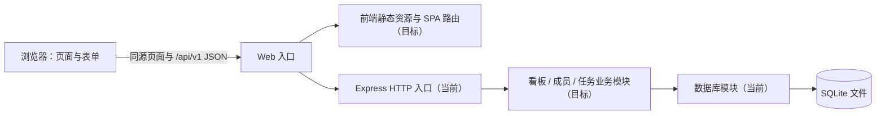

# 团队任务协作看板：系统架构

版本：0.6｜日期：2026-10-27｜状态：S0 已完成；S1～S4 的实现与自测完成（被测代码提交 `c077db9`，证据见 [verification/](verification/README.md)），S5 未选择，RELEASE 待打包与发布标签

本文解释系统边界、关键运行语义和技术决策。用户场景、字段、业务规则、数据库约束与 API 契约以 [spec.md](spec.md) 为唯一事实来源；切片分工见 [tasks.md](tasks.md)，验收见 [checklist.md](checklist.md)。本文不复制这些契约。

“当前”表示仓库已有实现；“目标”表示后续切片需要达到的结构。目标内容不能作为已实现能力或测试通过的证据。

## 1. 架构目标与约束

核心链路是“建看板 → 建任务 → 指定负责人/日期 → 修改状态 → 刷新和重启后可查看”。架构优先支持短反馈循环：每个切片都能独立启动、测试和演示，而不是等待所有技术层完成后集成。

| 约束 | 取舍 |
| --- | --- |
| 本地课程演示 | 一个后端进程、一份 SQLite 文件；构建后同源提供页面与 API |
| AI 生成端到端切片 | 保持模块边界清晰和测试可运行，共享规则集中，避免跨文件重复契约 |
| 多浏览器共享数据 | SQLite 是持久化来源；浏览器保存快照，人工刷新读取新数据 |
| 无登录与实时要求 | P0 所有访问者均可编辑；不使用 WebSocket、SSE、轮询或自动冲突合并 |
| 控制复杂度 | 不拆微服务，不引入 Redis、消息队列、容器编排、通用 Repository 或依赖注入框架 |
| 演示规模 | 按 10 看板、合计 200 任务、4 会话观察，不据此承诺生产容量 |

## 2. 技术基线与当前实现

| 部分 | 基线 | 当前状态 |
| --- | --- | --- |
| 页面 | Vue 3 + TypeScript + Vite；页面级响应式状态 | 已实现前端工作区（路由、三列、表单、详情、健康门禁） |
| HTTP 后端 | Node.js、TypeScript strict、Express 5 | 已实现 `createApp`/`server` 分离、健康检查、安全边界、成员/看板/任务 API |
| 持久化 | `better-sqlite3`、参数化 SQL、无 ORM | 已实现连接、约束、初始化、迁移、固定成员种子与演示数据 |
| 仓库 | npm workspaces、单一根锁文件；后续增加 frontend/shared | 已包含 shared/backend/frontend 三个工作区与统一锁文件 |
| 测试 | Vitest、Supertest、临时真实 SQLite；后续增加浏览器回归 | 已有 186 项单元/集成测试、一键 HTTP 回归与双浏览器 E2E 脚本 |

当前记录环境为 Node.js 18.17.1，`engines >=18.17`；Node 22 LTS 是待课程机复核的目标基线。版本与命令以实际 `package.json`、锁文件和 README 为准。

## 3. 运行视图与依赖方向



开发时 Vite 将 `/api` 代理到 `127.0.0.1:3000`；代理目标使用 IPv4 回环地址，避免 Windows 上 `localhost` 的 IPv6 解析差异。构建演示时 Express 同源提供前端静态资源和 API，API 路由先于 SPA 回退，未知 `/api` 始终返回 JSON 404。

模块依赖保持单向：

```text
页面 → 页面交互 → API 客户端 → HTTP 入口 → 业务模块 → SQLite
页面与业务模块 → shared 中的 DTO、枚举和纯规则（S1 建立）
```

- 页面不拼 SQL；数据库模块不引用 Express 请求/响应；业务方法不接收 HTTP 对象。
- shared 只包含浏览器与 Node 都可使用的类型和纯函数，不导入框架、文件系统、数据库或秘密。
- API 使用显式 DTO，不直接序列化数据库行；camelCase/snake_case 映射集中在后端数据边界。
- 数据访问采用具体模块方法；只有时钟、网络故障等实际变化点需要可替换 Adapter。
- shared 出现后，构建顺序为 shared → frontend/backend，开发脚本需保证两端不会读取旧产物。

## 4. 前端目标结构

### 4.1 状态边界

1. **服务器快照：** 看板、成员、当前看板和任务；每组资源区分 idle/loading/ready/error，读取失败不能转成空数组。
2. **交互草稿：** 当前 boardId、打开的任务、表单副本、dirty、saving 和删除确认；取消编辑不影响快照。
3. **派生状态：** 三列分组、负责人显示名和逾期标记；由快照计算，不另存一份数据库副本。

P0 任务不写入 localStorage。P2 若选择分享，维护密钥仅存当前标签页 sessionStorage，任务内容仍从服务端读取。

### 4.2 请求与编辑语义

- 每次看板加载绑定请求序号和 boardId；切板清理旧任务并显示加载骨架，过期响应不得覆盖当前看板。
- 刷新重新读取成员、看板列表、当前看板和任务；成功更新最后刷新时间，失败保留旧数据并标记可能已过期。
- POST/PUT 成功后以服务器返回对象更新快照，DELETE 在 204 后移除卡片；不展示未确认的假成功。
- 同一表单保存期间禁止重复提交。写请求超时或响应丢失后由用户刷新查证，不自动重放。
- PUT 提交完整可编辑字段。编辑时比较 `updatedAt` 只用于提示可能覆盖，不构成锁或冲突合并。
- 健康检查失败显示阻断提示和重试；渲染异常与未处理 Promise 进入可恢复错误页，不留下空白工作区。

原型位于 `prototype/screenshots/` 与 `prototype/styles/global.css`，是 UI 生成和评审的输入，不是运行时代码。

## 5. HTTP 与业务边界

### 5.1 当前后端已有能力

- `app.ts` 组装安全响应头、请求日志、Host 白名单、路由、API 404 和错误处理；测试可直接加载应用。
- `server.ts` 负责配置、数据库、结构兼容检查、监听、HTTP 客户端错误与退出。
- 健康路由检查数据库与迁移结构；测试环境提供故障注入路由。
- 统一写路由 `writeRoute` 组合媒体守卫、32 KiB JSON 解析和错误映射。

### 5.2 请求处理不变量

1. 安全头和日志先进入；日志不记录正文、查询串、密钥或 token。
2. Host 不在允许列表时返回 403，不进入业务查询。
3. 路由匹配先于正文处理；未知 `/api` 路径或方法统一 404，带正文时关闭连接。
4. 匹配写路由后依次执行 415 → 413 → 400 → 422 → 业务错误 → 500。新增写路由必须复用 `writeRoute`。
5. P2 分享若实施，公开分享读取与健康检查之外的私有 API 先验证维护密钥，再进入业务处理。
6. 业务模块负责关联、默认值与事务；HTTP 层只解析输入并包装 DTO/错误。

完整状态码、错误对象和路由表见 spec 第 9 节。这里不再维护第二份接口清单。

## 6. 数据、事务与并发

### 6.1 当前数据边界

- `boards`、`members`、`tasks` 与 `schema_migrations` 已由迁移建立；准确字段、CHECK 和索引见 spec 第 8 节及实际迁移。
- 每个连接显式启用外键并设置 `busy_timeout=5000`，默认不使用 WAL。
- 迁移文件采用四位连续编号和 SHA-256 校验和；缺号、重号、未知更高版本或校验和变化都会阻止启动。
- 初始化显式执行，正常启动不会因库文件缺失而创建替代空库；固定成员种子幂等，不清除业务数据。

### 6.2 业务切片必须保持的规则

- 任务查询与写入同时包含 boardId 和 taskId；跨板资源按不存在处理。
- 多 SQL 写操作使用短事务，共同提交或回滚；事务中不等待 HTTP 或用户操作。
- P0 全量 PUT 由后提交成功的更新覆盖先前更新；`updatedAt` 不作为版本锁。
- `better-sqlite3` 是同步驱动，锁等待会阻塞事件循环。健康探针使用独立只读连接和约 200 ms 等待，不承诺并发写吞吐。
- 服务端不设置应用层请求超时；客户端 10 秒超时只结束本地等待，不代表服务端未提交。

### 6.3 升级、备份与恢复目标

- 新迁移只追加，不改写已应用版本；同时验证空库初始化、重复初始化与旧库升级。
- 备份前停服并关闭连接；恢复时核对备份、迁移编号和校验和，恢复失败不自动删库、降级或换空库。
- 演示重置是独立且默认要求确认的命令，只清理演示数据；普通初始化没有破坏性。
- 数据库、备份、日志和 `.env` 不进入仓库或前端静态目录。

## 7. 配置与生命周期

配置键及示例以 `.env.example` 为直接入口，当前包括 `HOST`、`PORT`、`ALLOWED_HOSTS`、`DATABASE_PATH`、`NODE_ENV` 和四个 `ENABLE_*` 开关。`EDITOR_KEY` 只在选择 P2 后纳入实现。

启动顺序：

```text
读取并校验配置 → 打开既有数据库 → 核对迁移与功能开关
→ 组装 HTTP 应用 → 监听端口
```

任一失败均明确退出，不自动换端口、换库或降级。运行期数据库不可读、锁超时或结构变化映射为 503；未预期错误为脱敏 500。API 响应使用 no-store、nosniff 与防嵌入基线；默认回环监听和 Host 白名单用于降低 DNS rebinding 风险。

当前扩展尚未实现，四个功能开关必须全部为 0。后续只有在“迁移 + 实现 + 测试 + 验收”同时完成后才能开启对应能力。

## 8. 扩展位置与验证策略

| 扩展 | 架构增量 | 约束 |
| --- | --- | --- |
| 优先级与筛选 | priority 列、查询白名单和必要索引；shared/API/UI 同步扩展 | 筛选依赖优先级；筛选生效时禁用拖拽 |
| 拖拽与排序 | sort_order、移动事务和稳定回填；普通创建/状态修改同步维护顺序 | 保留状态按钮；触屏不承诺拖拽；过期 move 响应不得覆盖新数据 |
| 只读分享 | 私有维护密钥、token 哈希、公开最小读取、独立分享页 | 同时交付访问控制、撤销、no-store/no-referrer、CSP 与日志脱敏 |

验证分三层：

1. 纯规则测试覆盖文本、枚举、日期和边界；
2. 临时真实 SQLite + HTTP 测试覆盖约束、事务、归属和状态码；
3. 浏览器测试覆盖真实闭环、竞态、双会话、响应式和恢复。

能自动化的 CHECK 随对应切片转为回归测试；Chrome/Edge 实际适配、干净环境、备份恢复和最终演示仍需人工记录。构建通过不等于业务验收通过。

## 9. 已确认技术决策

2026-10-21，四名成员逐条确认 D-01～D-27 与 spec v0.4，TASK-001 完成。以下保留原编号和有效含义，删除已完成的任务归属与重复契约文本。业务细节以最新 spec 为准；推翻决议时新增编号并标记旧决议已废止，不复用编号。

| 编号 | 决策摘要 |
| --- | --- |
| D-01 | API 基路径 `/api/v1`；P0 未定义私有方法/路径统一 JSON 404，不使用 405 |
| D-02 | 成功包装 `data`，错误包装 `error.code/message/fields?`；204 无正文且不解析 JSON |
| D-03 | 路由匹配先于正文；匹配写路由按 415→413→400→422→业务错误处理；新增写路由复用 `writeRoute` |
| D-04 | 空正文 POST/PUT 进入字段校验并返回 422，DELETE 按契约执行，不因空正文返回 415 |
| D-05 | DELETE 无业务正文；非 JSON 正文 415，JSON 正文解析后忽略，不得改变 ID 或归属 |
| D-06 | 未知/受保护 JSON 字段为 400；字段类型、长度、日期、枚举和关联值非法为 422 |
| D-07 | 未知或重复查询键为 400；P0 任务列表无查询参数，P1 只接受白名单条件 |
| D-08 | 请求体按原始字节限制 32768；只接受 UTF-8 JSON，超限不得进入业务层 |
| D-09 | 默认 `127.0.0.1:3000`；端口冲突或不可用即启动失败，不自动换端口 |
| D-10 | 配置键以 `.env.example` 为基线；开关只接受 0/1，filters 依赖 priority，分享要求有效密钥；错误配置退出且不打开/新建数据库 |
| D-11 | npm workspaces 单仓单锁；后端 TypeScript strict + Express 5 + better-sqlite3；shared 在 S1 建立；Node 22 目标仍需课程机复核 |
| D-12 | 每连接启用外键和 5000 ms 锁等待；库文件缺失启动失败；健康探针独立连接、短等待并核对结构 |
| D-13 | 健康响应固定包含四个功能开关，不暴露路径、版本或耗时；失败为脱敏 503，P2 下仍公开 |
| D-14 | 日志仅记录方法、脱敏路径、状态、耗时和错误类型；秘密、token、正文、SQL 与绝对路径不进入日志或响应 |
| D-15 | P0 不含登录、成员管理、看板改名/删除、实时同步、分页、评论、附件、搜索或冲突合并；扩展必须迁移、实现、开关和验收齐全 |
| D-16 | 集成测试使用独立临时真实 SQLite，不写仓库 data；后端命令采用 `dev:backend/test:backend/build:backend/typecheck` |
| D-17 | 业务日期按 Asia/Shanghai 由入口时钟传入纯规则；截止日期不做 UTC 转换；测试使用固定时钟 |
| D-18 | JSON 顶层只接受对象；危险原型键为 400；服务端白名单取值，不做请求体对象合并 |
| D-19 | 名称/标题与描述按 spec 拒绝指定控制、零宽和双向字符；允许 emoji 组合所需 ZWJ/ZWNJ |
| D-20 | 日期使用纯字符串和自实现闰年/月天数规则，年份 0001～9999，不用 `Date` 解析 |
| D-21 | Host 默认只接受 127.0.0.1、localhost、[::1]；非回环监听必须显式配置 ALLOWED_HOSTS |
| D-22 | API/分享响应统一 no-store、nosniff 和防嵌入；分享页使用严格 CSP；错误不回显用户输入 |
| D-23 | 任何成功 PUT 刷新 `updatedAt`；它只用于展示、覆盖提示和排查，不用于并发锁 |
| D-24 | 同步驱动锁等待会阻塞进程；服务端无应用层超时，客户端超时后人工查证，不承诺写吞吐 |
| D-25 | 主提示由前端按 code 映射，字段错误使用服务端固定短文案；message 仅兜底/日志并集中维护 |
| D-26 | P2 密钥解码后至少 32 字节并拒绝弱值；失败限流为进程内；无 TLS 仅限可信网络，密钥轮换不自动撤销 token |
| D-27 | 迁移采用连续四位编号和校验和；停服备份并核对恢复结构；演示重置独立且默认确认 |

### 9.1 未采纳方案

| 方案 | 当前理由 |
| --- | --- |
| 全局挂载 JSON/媒体守卫 | 会让未知路径优先返回 413/415，破坏 D-03 |
| 自动建空库或内存库兜底 | 会掩盖配置错误和潜在数据丢失 |
| 页面隐藏按钮代替服务端授权 | 不构成只读或访问控制 |
| 自研重复 JSON 键检测 | 成本高于课程项目收益；采用危险键拒绝与白名单取值 |
| 通用限流、应用层请求超时、自动冲突合并 | 当前演示范围不需要，相关限制明确保留 |
| 看板改名/删除 | 不属于 P0；演示数据通过独立重置流程处理 |

课程技术栈、CI、运行环境和额外 AI 交付要求仍以 spec 的假设与待确认项为准，不能把团队假设表述为课程硬性要求。
