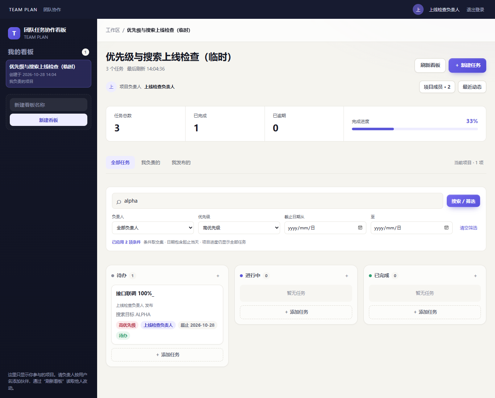
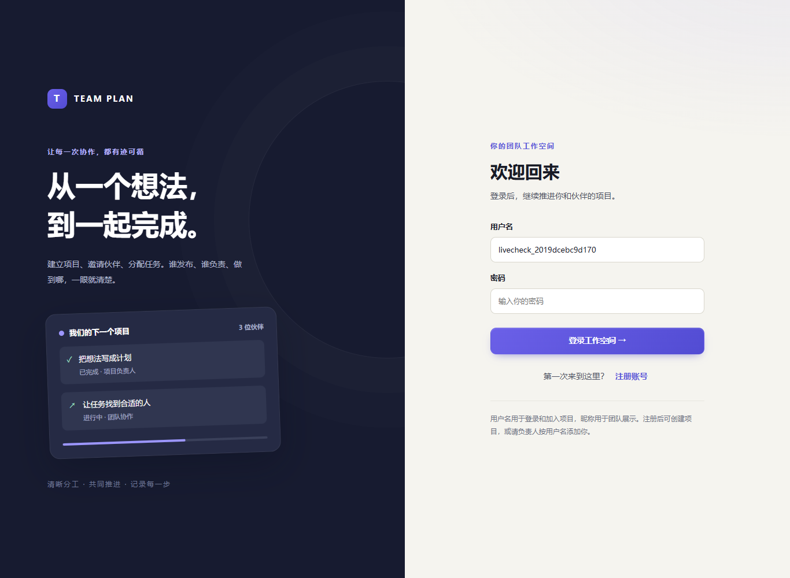
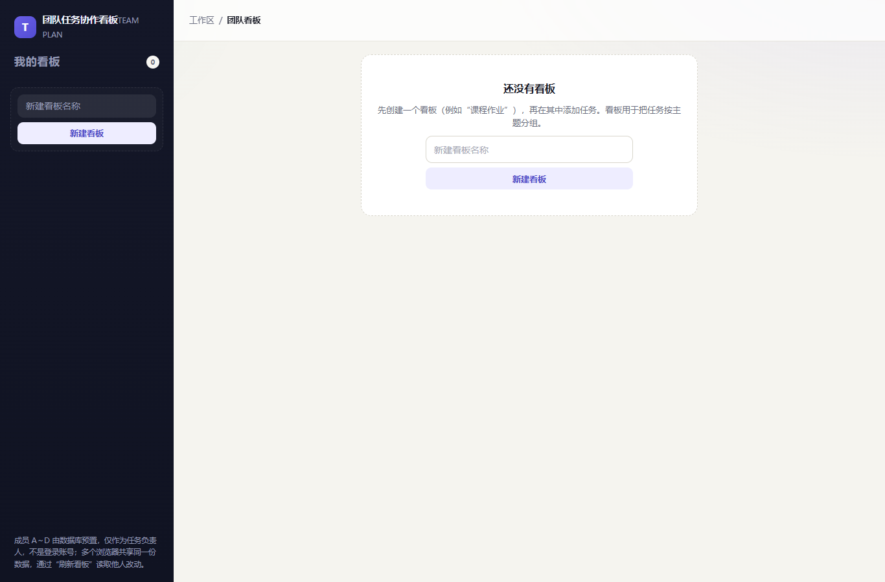

# 优先级与搜索筛选部署（当前）

**已上线：[tboard.bigdogaaa.cn](https://tboard.bigdogaaa.cn/)**。2026-10-28 14:04（北京时间）完成升级；刷新页面后可使用优先级和组合搜索。

| 项 | 实际值 |
| --- | --- |
| 部署源码 | `f1ea704a0d688c12aac342fae6206ca03f62d696` |
| 部署包 SHA256 | `66a0e6c7540102002ef5c84c042b02a34d81b4c476a34e7ed21bab23c2d86cc1`，服务器一致 |
| 数据结构 / 开关 | 0003；priority=true，filters=true；ordering/sharing=false |
| 升级前快照 | `/var/backups/team-task-board/deployment-20261028T060410Z/database.sqlite`，配置一并备份 |
| 旧数据核对 | 停服后逐行比较：1 账号、1 会话、1 项目、1 项目成员、0 任务、1 动态、4 历史成员全部原样保留 |
| 服务 / 备份 | 应用 active/enabled；备份 timer active/enabled，14:05:26 最后备份 success |

- 本地 229 项测试、类型/构建、搜索 HTTP + 两品牌 UI 15/15、兼容 API 50/50、原协作 22/22、账号 8/8，以及故障/竞态补验通过，详见 [S5 验证](../verification/task-search/README.md)。生产依赖审计 0 项。
- Linux 暂存目录重新安装 134 个生产包（审计 138），0 vulnerabilities；兼容模式 50/50，开启模式真实服务搜索契约 3/3 通过。激活前 bash 语法检查通过，0003 后逐行旧数据校验通过再开放写入。
- 实际公网检查 **8/8**：HTTPS/开关、匿名 API 401、真实账号与 Cookie、项目隔离与优先级、字面关键词/AND/包含端点日期、非法/重复参数、真实 Edge 登录与组合查询、编辑移出仅一次 PUT 和刷新持久化。见 [机器结果](../verification/task-search/public-results.json)。
- 仅按精确 ID 清理本轮 2 个合成账号、1 个临时项目和 3 个临时任务；最终仍保留原有 1 个账号和 1 个项目，任务 0；外键与完整性正常。上一轮删除授权未复用。
- 原主站 / Fieldnotes / OpenCode 发布前后均 **200 / 200 / 302**。沿用现有 TLS，暂存私钥已移除。
- 独立人工复验未执行，按用户授权不阻塞部署。

---

以下保留历史版本证据，当前运行源码与状态以上方为准。
# 账号协作版公网部署（当前）

**已上线：[tboard.bigdogaaa.cn](https://tboard.bigdogaaa.cn/)**。2026-10-28 13:07（北京时间）完成升级；入口直接显示个人登录/注册页，旧统一 team 密码不再用于站点访问。

| 项 | 实际值 |
| --- | --- |
| 部署源码 | `b8ff7cb266e673780b70ee48df4c26ab36724c20` |
| 部署包 SHA256 | `a5621bb3b07d0f2fcc8f848589c54bd1dccffa512eae69e43f0cd7d97104f70e`，服务器核对一致 |
| 服务 | active / enabled，仅 127.0.0.1:4100 |
| 数据结构 | 0002，个人账号、摘要会话、项目成员、负责人、发布者和动态 |
| 访问边界 | 页面/资源公开；私有 API 个人会话 + CSRF + 项目成员授权 |
| 升级前备份 | `/var/backups/team-task-board/deployment-20261028T050721Z/`，配置与一致数据库快照 |
| 清理后的备份 | 2026-10-28 13:08:47，backup service success；每日 timer active/enabled |
| 证书 | 沿用同域名证书，有效至 2027-01-25 18:59:59（北京时间）；暂存私钥已移除 |

- 本地 207 项测试、类型/生产构建、API 50、跨浏览器 22、8 组账号协作、两品牌故障/尺寸/键盘/竞态及 S1 重启通过，详见 [S6 验证](../verification/accounts-projects/README.md)。生产依赖审计为 0 项。
- 服务器 Linux 从锁文件安装 134 个生产包（审计 138），0 vulnerabilities；临时真实 SQLite 的 HTTP 回归 50/50 通过，激活前 bash 语法检查通过。
- 实际 HTTPS 公网检查 **10/10**：公开登录/资源、匿名私有 API 401、两个账号注册及 Secure/HttpOnly/Strict Cookie、项目隔离 404、CSRF/跨源拒绝、成员角色、发布者/负责人、真实 Edge 个人视图、改密撤销旧会话、退出、动态及移除成员、未知 API/HTTP 308。见 [公网机器结果](../verification/accounts-projects/public-results.json)。
- 用户明确授权删除原有 1 个项目和 1 个任务；先保存精确 ID 与升级前备份，再事务删除这两个记录。新用户或其他项目不在清理条件内。
- 公网测试的 2 个合成账号、1 个临时项目和 1 个临时任务全部按精确 ID 清理；完整性 ok。最终检查时 users/boards/tasks 均为 0，四名历史演示成员仅作为兼容记录保留。
- 原主站 / Fieldnotes / OpenCode 发布前后仍为 **200 / 200 / 302**。
- 非主驾人工独立验收未执行，按用户决定不阻塞上线；不把本地或公网自动化冒称人工验收。

---

# 历史：2026-10-27 统一密码版本

以下为旧部署事实，保留原始证据；访问方式及当前版本以上方账号版为准。
# 公网部署记录

**已上线：<https://tboard.bigdogaaa.cn/>**。启用时间：2026-10-27 21:35（北京时间）。用户已明确不等待组员独立复验，本次不宣称其已执行。

| 项 | 实际值 |
| --- | --- |
| 部署源码 | `2de2cde136b6b93c4b4f02f6f6533ac4b2f6df01` |
| 部署包 SHA256 | `20a70be99f45bf0cd9e2a5764598ad72f35c64d356d212570974ab93a063ca07`（服务器传输后核对一致） |
| 服务器 | `49.232.195.47`，Linux，Node 24.9.0、npm 11.6.0、Nginx 1.28.3 |
| 代码入口 | `/opt/team-task-board/current` → `/opt/team-task-board/releases/2de2cde136b6b93c4b4f02f6f6533ac4b2f6df01` |
| 服务/监听 | `team-task-board.service`：active、enabled；仅 `127.0.0.1:4100` |
| 数据库 | `/var/lib/team-task-board/team-plan.sqlite`，teamboard:teamboard、0600；初始四成员、空工作区 |
| 访问边界 | Nginx 全站 Basic Auth，账号 `team`；页面、资源、API 均保护，持有密码者均可编辑 |
| TLS | SAN 匹配 `tboard.bigdogaaa.cn`，有效到 2027-01-25 18:59:59（北京时间），私钥 root:root、0600 |
| 口令权限 | 交付文件 root:root、0600；Nginx 哈希文件 root:www-data、0640；明文未写入 Git 或报告 |
| 部署备份 | `/var/backups/team-task-board/deployment-20261027T133532Z/` |
| 数据定时备份 | `team-task-board-backup.timer` enabled，每天北京时间 02:30 后五分钟内执行 |
| 首次在线备份 | 成功；`/var/backups/team-task-board/database/team-plan-20261027T133535411935Z.sqlite`，完整性为 ok |

## 实际检查

- 本轮本地 188 项业务测试、typecheck、build 通过，Vue/SSR 与 body-parser 的生产依赖审计项已处理，`npm audit --omit=dev` 为 0。
- 服务器以 ubuntu 普通账户安装 134 个 Linux 运行依赖，生产审计 0 项；`node scripts/http-regression.mjs` 使用临时 SQLite，50/50 通过。该检查在 `928a692` 暂存版本执行；最终 `2de2cde` 仅调整部署脚本/记录，应用代码与锁文件相同，并经 `cmp` 核对后复用该批运行依赖。
- 最终站点公网检查 **12/12 通过**：匿名页面/API/深链接与匿名写入为 401，错误密码为 401；正确凭据访问首页/资源/健康/成员/看板成功；未知 API 为 JSON 404；HTTP 308 保留路径与查询；真实 Edge 浏览器成功加载空工作区，无运行期错误。
- 公网检查未新增业务看板或任务；匿名写入被拦截后数据库看板数仍为 0。
- 发布后主站/Fieldnotes/OpenCode 为 **200/200/302**，与发布前一致；独立配置未改写这些站点。
- 最后 `nginx -t` 成功，服务及备份 timer 均 enabled；数据库和秘密不在前端静态目录。三个暂存目录中的私钥副本已删除，用户原始 ZIP 保留。

公网检查详情：[public-deployment-checks.json](../verification/public-deployment-checks.json)。

## 本轮失败与修正

1. 首次 Windows Git archive 导出 CRLF shell 文件，被 Linux `bash -n` 在激活前拦截；新增 deploy 文件的 LF 属性后重新打包，包内无 CR 字节。
2. 首次激活在 Nginx 热重载后立即校验 HTTPS，命中过渡期旧 worker 的默认证书；脚本成功自动回退，原站点状态一致。增加有限重试且保留 TLS 验证后，第 2 次探测取得正确域名证书和 401 保护页，上线成功。
3. 本地口令交付目录的 ACL 处理曾造成所有者读取失败；自动审批拒绝额外向 SYSTEM/管理员授权后，采用仅恢复现有文件所有者权限的方案，随后公网登录检查成功。未增加其他访问主体，也未显示明文口令。

证书不自动续签，操作方式见 [README](README.md)。后续更新使用新固定提交；不覆盖 `/var/lib` 持久库，不自动重置口令。
