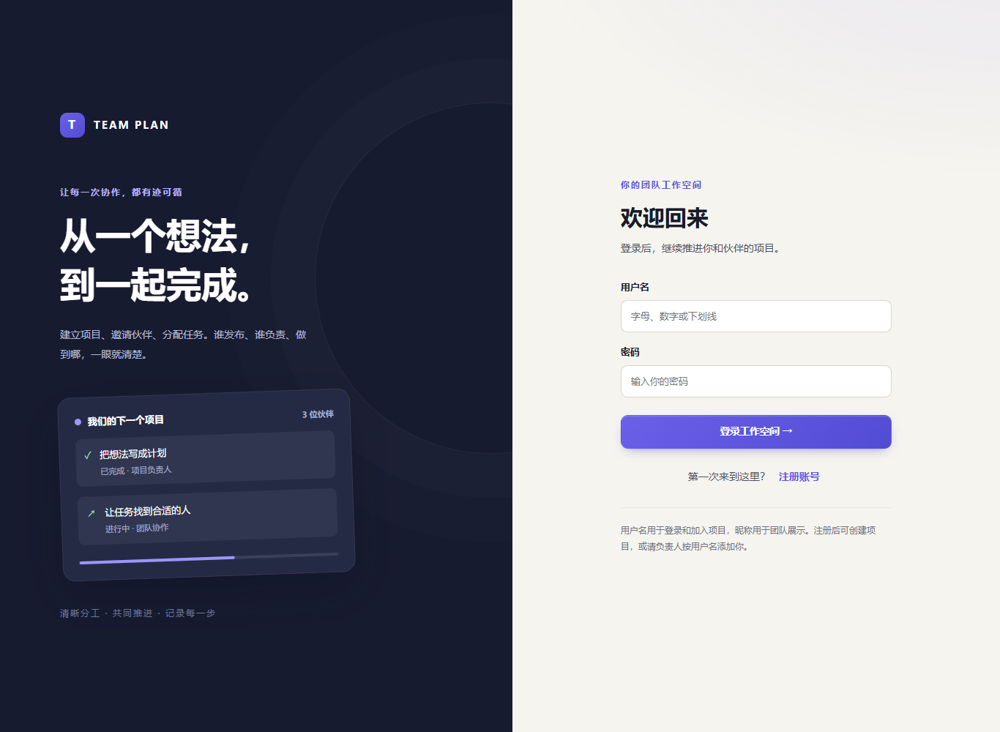
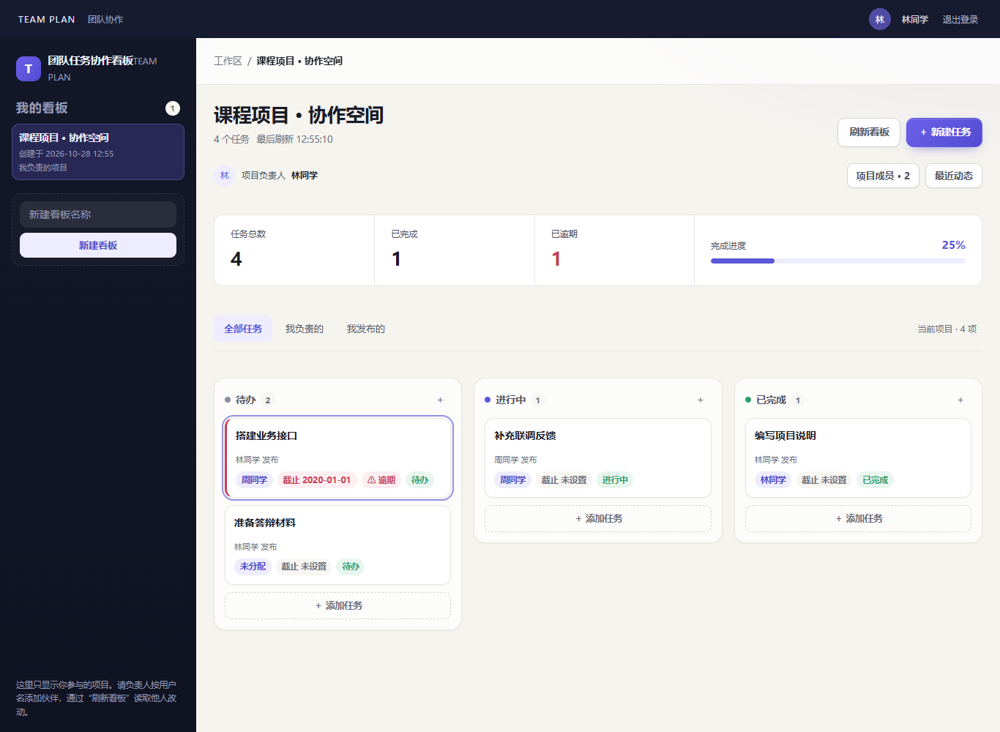
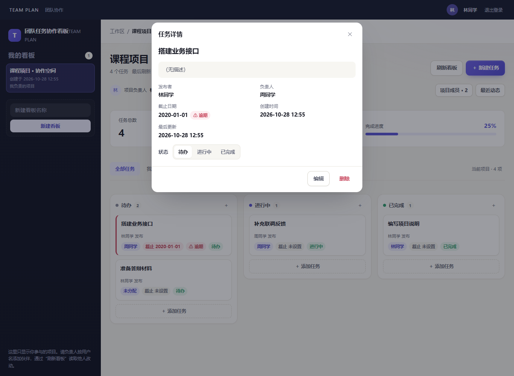
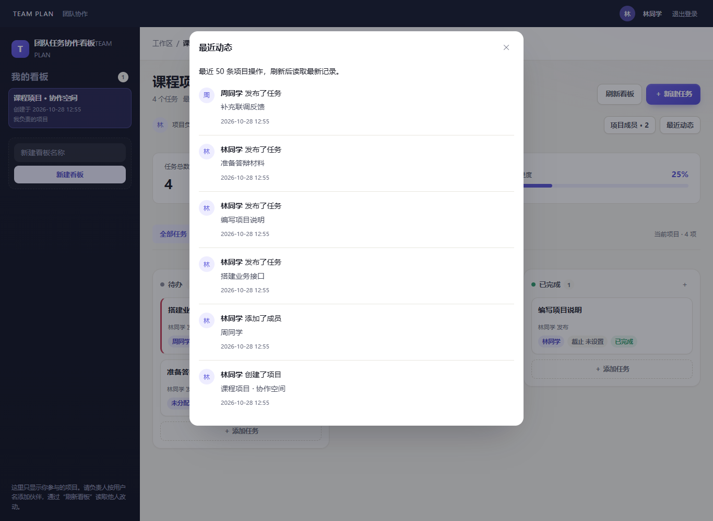

# 账号与项目协作验证

日期：2026-10-28；S6，REQ-020～025 / CHECK-059～066。截图使用临时真实 SQLite 与合成课程数据，运行结束清理临时库，不是静态原型。

## 实现

- 个人注册、登录、恢复会话、退出、昵称、修改密码；密码 scrypt（N=131072/r=8/p=1）、随机盐，最多 2 个并行 KDF，持久身份限流。
- 7 天服务端摘要会话、HttpOnly/SameSite=Strict/生产 Secure Cookie、同源和 CSRF 校验；改密撤销全部旧会话。
- 项目成员隔离、负责人管理成员/转交；任务发布者与任务负责人分别记录，移除成员解除分配并立即拒绝访问。
- 当前项目的全部/我负责/我发布视图、完成与逾期统计、最近 50 条动态。
- 0001→0002 无损迁移和显式历史项目接管；旧项目不会归给首位注册用户。用户另外明确授权删除当前线上仅有的旧项目和任务，实际执行单独记入部署记录。

## 实际结果

| 检查 | 结果 |
| --- | --- |
| shared / backend / frontend | 16 / 130 / 61，共 207 项通过 |
| 类型、生产构建 | 通过 |
| HTTP / API 回归 | 50/50，通过真实个人会话，负责人须是项目成员 |
| 既有跨浏览器 E2E | 22/22，Chrome 156.0.8078.47 + Edge 156.0.4314.42 |
| 账号双人协作 | 8/8，真实 UI 注册、邀请、任务归属、个人视图、资料/改密、转交/移除 |
| 浏览器补验 | Chrome/Edge 各 1366/768/360 完整 CRUD、键盘、422/500/503/10s 超时/已提交响应丢失、慢响应竞态均通过 |
| S1 进程重启持久化 | Edge 通过；刷新、重启、重复初始化后任务字段及真实成员 ID 一致 |
| 浏览器启动器 | 5/5，通过 |
| 非主驾人工独立验收 | 未进行，不冒称完成，按用户要求不阻塞部署 |

环境：Windows，Node 24.18.0，npm 11.16.0。浏览器机器结果见 [browser-results.json](browser-results.json)。

## 复现

```powershell
npm ci
npm test
npm run typecheck
npm run check:api
# 本机需已安装相应品牌；也可用 E2E_EXECUTABLE_A/B 指定便携版
$env:E2E_BROWSER_A='chrome'
$env:E2E_BROWSER_B='msedge'
npm run check:accounts
npm run check:browser
npm run test:e2e:s1
```

各脚本拥有独立临时库和端口；不修改仓库或线上业务库。旧契约单元夹具显式使用仅限 test 环境的匿名模式；账号集成及全部浏览器脚本使用真实登录，不能将匿名夹具当作权限通过证据。

## 实际失败与修正

1. 沙箱回环连接 EACCES；在正常批准环境重跑，未把连接失败当作业务缺陷。
2. 迁移回归原来仅认 0001，更新其版本断言，并新增旧库数据完整升级及接管回归。
3. 成员保存时禁用输入导致焦点落到 body，Escape 不到达弹窗。改为弹窗生命周期内监听 document 键盘，并覆盖失焦/Tab 恢复及卸载清理。
4. 注册后退出仍显示注册表单；退出与过期时显式切回登录，并通过旧密码拒绝/新密码登录的真实流程。
5. 原浏览器脚本默认共享匿名工作区；改为创建独立账号并传播 Cookie/CSRF；每个新会话创建自己的初始项目，不借用他人数据。

## 运行截图






窄屏：[登录 360](login-360.png)、[项目 768](project-768.png)、[项目 360](project-360.png)。

## 公网部署

账号版已于 2026-10-28 13:07（北京时间）上线。实际 HTTPS 10/10 及真实 Edge 链路通过；机器结果见 [public-results.json](public-results.json)，[真实公网登录页](public-login.png) 与 [真实公网临时协作项目](public-project.png)。临时账号/项目/任务已清理。固定源码和升级前备份见 [部署记录](../../deploy/DEPLOYMENT.md)。
